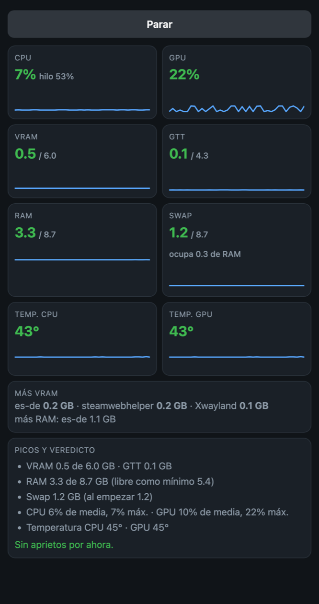

# ps5-bazzite-toolbox

Caja de herramientas para **Linux en la PS5** con la imagen
[VivaLaVent/ps5-bazzite-deck](https://github.com/VivaLaVent/ps5-bazzite-deck) (Bazzite Deck: Steam en modo juego
y escritorio KDE). Es **un solo fichero** que se ejecuta en la consola y sirve para:

- **Diagnosticar** problemas sin cambiar nada, y dejar un informe para pedir ayuda.
- **Recuperar la pantalla o la sesión gráfica** cuando se queda en negro.
- **Poner a punto un sistema recién instalado**: idioma, VRAM, ventilador, NAS, EmuDeck/ES-DE… bloque a bloque,
  explicando cada cambio y preguntando antes.
- **Añadir y quitar juegos de Windows** en PortProton y Steam en un paso, normales o aislados del resto del sistema.
- **Cambiar de versión de la imagen** desde GitHub (más nueva o anterior) con comprobación de SHA-256, y volver a
  como estaba antes (en pruebas).

Todo está en español. No es un proyecto oficial de la imagen ni de sus autores.

**Equipo de pruebas** (versiones v1.4 – v1.8 de la imagen, instalación Legacy):

| | |
|---|---|
| Consola | PS5 original «fat» (chip Wi-Fi/Bluetooth IW620), firmware 4.50 |
| Jailbreak | [ps5-y2jb-autoloader](https://github.com/itsPLK/ps5-y2jb-autoloader) |
| Cargador de Linux | `ps5-linux-loader-v3.5.elf` ([ps5-linux-loader](https://github.com/ps5-linux/ps5-linux-loader)) |
| Envío del cargador | [PS5 Payload Manager](https://github.com/itsPLK/ps5-payload-manager) |
| Disco | SSD externo Lexar ES3 de 1 TB por USB 3.2 (10 Gb/s, USB `21c4:0003`; va estable con `usb-storage.quirks=21c4:0003:um`, que pone el bloque `cmdline`) |

Con otros modelos (Slim, Pro), firmwares, cargadores o discos puede funcionar, pero no está probado.

Cada ajuste explica qué cambia, por qué y cómo deshacerlo, y aquí abajo está también **el comando equivalente**, por
si prefieres hacerlo a mano sin instalar nada.

## Índice

- [Uso rápido](#uso-rápido)
- [Opciones del menú y de la línea de comandos](#opciones-del-menú-y-de-la-línea-de-comandos)
- [Diagnóstico](#diagnóstico)
- [Pantalla y sesión gráfica](#pantalla-y-sesión-gráfica)
- [Ajustes de la consola](#ajustes-de-la-consola) (cada bloque en detalle, con sus comandos)
- [PortProton y Steam](#portproton-y-steam)
- [Cambiar de versión de la imagen y volver atrás](#cambiar-de-versión-de-la-imagen-y-volver-atrás)
- [Copia de seguridad de tu carpeta personal](#copia-de-seguridad-de-tu-carpeta-personal)
- [Ficheros: qué usa y dónde guarda cada cosa](#ficheros-qué-usa-y-dónde-guarda-cada-cosa)
- [Versiones de la caja de herramientas](#versiones-de-la-caja-de-herramientas)
- [Cosas que se hacen a mano](#cosas-que-se-hacen-a-mano)

## Uso rápido

En la PS5 (terminal o SSH):

```sh
curl -LO https://github.com/fitamix/ps5-bazzite-toolbox/releases/latest/download/ps5-bazzite-toolbox.sh
bash ps5-bazzite-toolbox.sh
```

Ese enlace descarga siempre la **última versión publicada**. La rama `main` puede llevar cambios aún sin publicar.

La primera vez se ofrece a **instalarse** como el comando `ps5-bazzite-toolbox` (en `~/.local/bin`, sin `sudo`; las
actualizaciones de la imagen no lo borran) y como «Caja de herramientas PS5» en el menú de aplicaciones de KDE.
A partir de ahí basta con `ps5-bazzite-toolbox`, y el fichero descargado ya se puede borrar. Si prefieres no
instalarla, sigue funcionando con `bash ps5-bazzite-toolbox.sh`.

Se ejecuta con tu usuario (no como root). La contraseña de `sudo` la pide solo la primera vez que eliges algo que la
necesita, y no vuelve a pedirla hasta que la cierras.

## Opciones del menú y de la línea de comandos

Sin opciones muestra un menú (sin terminal, por ejemplo lanzada desde otro script, hace el diagnóstico). Cada opción
tiene su equivalente sin menú (`ps5-bazzite-toolbox --…`, o `bash ps5-bazzite-toolbox.sh --…` sin instalar) y, cuando
lo hay, un comando del sistema que hace lo mismo.

| Menú | Qué hace | Sin menú | Comando equivalente (sin la caja) |
|---|---|---|---|
| **Diagnóstico** (solo mira) | | | |
| 1 | Revisión completa de este arranque y guarda el informe | `--check` | `journalctl -k -b 0` y `journalctl -b 0` (la caja además los interpreta) |
| 2 | Lo mismo con el arranque anterior (tras un cuelgue o un apagado forzado) | `--check --boot -1` | `journalctl -k -b -1` |
| 3 | Vigilar el kernel en directo (Ctrl+C vuelve) | `--watch` | `sudo journalctl -k -f -n 0` |
| 4 | Vigilar CPU, GPU, VRAM, RAM, swap, temperatura y qué gasta más | `--mem` | — (lee `/sys/class/drm/card*/device/mem_info_*`, `/proc/meminfo`, `sensors`…) |
| **Pantalla y sesión** | | | |
| 5 | En qué sesión arranca la consola y cuál hay ahora | `--session status` | `loginctl list-sessions`; `systemctl is-active sddm` |
| 6 | Pantalla en negro: recuperar la imagen (no cierra nada) | `--screen` | `sudo chvt 2; sleep 3; sudo chvt 1` |
| 7 | Pantalla en negro que no se arregla con el 6: reiniciar la sesión (cierra Steam y lo abierto) | `--session restart` | ver [Pantalla y sesión](#pantalla-y-sesión-gráfica) |
| 8 | Pasar al escritorio KDE ahora y arrancar siempre en él | `--session desktop` | ver [Pantalla y sesión](#pantalla-y-sesión-gráfica) |
| 9 | Pasar al modo juego ahora y arrancar siempre en él | `--session gamemode` | `sudo rm /etc/sddm.conf.d/zzz-ps5-session.conf` y reiniciar la sesión |
| **PortProton y Steam** | | | |
| 10 | Instalar un juego de Windows (normal o aislado), probarlo y añadirlo a Steam | `--add-game [Juego.exe]` | — |
| 11 | Mis juegos: cambiar su aislamiento, la generación de fotogramas, o desinstalarlos | `--games`, `--change-level Juego.exe`, `--framegen Juego.exe`, `--remove-game [Juego.exe\|"Nombre"]` | — |
| 12 | Sincronizar la colección «PortProton» de Steam (cierra Steam) | `--pp-collection [--dry-run\|--yes]` | — |
| — | Lanzar un juego como lo dejó la opción 10 (lo usan Steam y el escritorio) | `--run Juego.exe` | — |
| **Utilidades** | | | |
| 13 | Lo que ocupa cada carpeta (también el comando `espacio` y el botón derecho de Dolphin) | `--space [carpeta]` | `du -bsh -- */ .[!.]*/ \| sort -h` |
| **Ajustes de la consola** | | | |
| 14 | Ver qué ajustes están aplicados | `--setup --status` | — |
| 15 | Aplicar los pendientes, uno a uno | `--setup` | — |
| — | Aplicar sin preguntar la respuesta recomendada en todos | `--setup --all` | — |
| 16 | Revisar o cambiar ajustes concretos (también los que dijiste que no) | `--setup --only vram,nas` | cada bloque, en [Ajustes](#ajustes-de-la-consola) |
| **Sistema** | | | |
| 17 | Imagen: instalar otra versión de GitHub, volver a como estaba antes de actualizar (en pruebas) o guardar una copia | `--update [v1.8.4]`, `--rollback` | ver [Cambiar de versión](#cambiar-de-versión-de-la-imagen-y-volver-atrás) |
| 18 | Actualizar esta caja de herramientas (muestra las novedades y pregunta) | `--self-update [v1.1.0]` | — |
| 19 | Instalarla como comando y en el menú de aplicaciones, o desinstalarla | `--install`, `--uninstall` | — |
| 20 | Copia de seguridad de tu carpeta personal: guardar (eligiendo qué) o recuperar, también desde otro disco | `--backup`, `--restore [carpeta]` | ver [Copia de seguridad](#copia-de-seguridad-de-tu-carpeta-personal) |
| — | Versión y ayuda | `--version`, `--help` | — |

## Diagnóstico

Solo lee. Al final ofrece guardar el informe (sin contraseñas; ver [Ficheros](#ficheros-qué-usa-y-dónde-guarda-cada-cosa))
y repasa lo que ha dado problemas en esta consola:

- **Disco USB:** atascos (`timing out command`), resets, errores de E/S y espacio libre.
- **Gráfica:** reinicios de la GPU, errores de memoria, VRAM disponible.
- **Sistema:** cuelgues del kernel, procesos bloqueados, falta de memoria, programas que se cierran de golpe, si el
  arranque anterior terminó mal.
- **Temperatura y ventilador**, **red** (router, DNS, Wi-Fi, Bluetooth, NAS), **sesión gráfica** y el estado de cada
  bloque de ajustes.

**Vigilar en directo** (opción 4): cada 2 s muestra la carga de CPU (media y el hilo más cargado) y de GPU, VRAM, GTT
(RAM que la gráfica toma prestada), RAM y swap, todo como usado/total, la temperatura de CPU y GPU y los programas que
más VRAM usan. La swap de Bazzite es zram (RAM comprimida): `2.5/4.3 GB (0.8)` son 2,5 GB en la swap que ocupan
0,8 GB de RAM. Al parar (Ctrl+C) resume los picos, dice si falta VRAM, RAM o las dos, si se llenó la swap y si el
límite es la GPU o un hilo de la CPU, y ofrece guardar cada medida en un CSV.

## Pantalla y sesión gráfica

- **Recuperar la imagen** (6): pasar a otra consola virtual y volver hace que la gráfica vuelva a configurar la
  salida HDMI. No cierra nada.
- **Reiniciar la sesión** (7): `systemctl restart sddm` deja vivo el compositor anterior y la pantalla sigue en
  negro. La caja cierra primero las sesiones y el compositor, y luego arranca SDDM. A mano:
  ```sh
  sudo systemctl stop sddm
  loginctl list-sessions                      # y por cada sesión del seat0: sudo loginctl terminate-session <id>
  sudo pkill -u "$USER" -x 'gamescope|gamescope-wl|kwin_wayland|plasmashell'
  sudo systemctl start sddm
  ```
- **Escritorio / modo juego** (8, 9): cambia en qué sesión entra la consola al arrancar y la reinicia ya. El
  escritorio se fija con `/etc/sddm.conf.d/zzz-ps5-session.conf`; sin ese fichero entra en el modo juego, como viene
  la imagen. A mano:
  ```sh
  printf '[Autologin]\nUser=%s\nSession=plasma.desktop\n' "$USER" | sudo tee /etc/sddm.conf.d/zzz-ps5-session.conf  # escritorio
  sudo rm -f /etc/sddm.conf.d/zzz-ps5-session.conf                                                                 # modo juego
  ```

## Ajustes de la consola

Los ajustes van en **bloques**. Cada uno, al ofrecerse, explica **qué cambia, por qué y cómo deshacerlo**, y
pregunta con una respuesta recomendada (`[S/n]` = sí por defecto, `[s/N]` = no). Lo que depende de cada consola
(disco, idioma, NAS…) lo detecta o lo pregunta.

- **Opción 15** (`--setup`) ofrece uno a uno los pendientes; **14** (`--setup --status`) solo enseña el estado:
  ✔ aplicado, ✘ pendiente, – no aplica en esta consola (o dijiste que no).
- **Opción 16** (`--setup --only vram,nas`) vuelve a un bloque concreto, aunque ya esté aplicado o le dijeras que no:
  es la forma de cambiar un valor o deshacerlo.
- **Tus respuestas** (idioma, VRAM, datos del NAS, bloques que no quieres…) se guardan en
  `~/.config/ps5-bazzite-toolbox.conf`, y la próxima vez solo ofrece lo pendiente.
- Algunos piden **reiniciar**, y los que tocan la memoria o la GPU, **apagar y arrancar con el cargador**
  (un reinicio, también el reinicio en caliente, no los cambia). Lo dice al final.

### Resumen

| Bloque | Qué hace | Recomendado | Reinicio |
|---|---|---|---|
| [`locale`](#locale) | Idioma, teclado, zona horaria y hora por red | sí | no |
| [`cmdline`](#cmdline) | Idioma en el arranque y arreglo para el disco USB, en `/efi/cmdline.txt` | sí | reiniciar |
| [`wifi`](#wifi) | Apaga o enciende el Wi-Fi según la versión de la imagen | sí | no |
| [`updates`](#updates) | Bloquea las actualizaciones que rompen la imagen | sí | no |
| [`vram`](#vram) | Memoria reservada para la gráfica | sí | apagar |
| [`gpu40`](#gpu40) | Las 40 unidades de cálculo de la GPU en vez de 36 | **no** (pruébalo tú) | apagar |
| [`zram`](#zram) | Swap comprimida del tamaño de toda la RAM | sí | reiniciar |
| [`fans`](#fans) | Control del ventilador y temperatura objetivo | sí | no |
| [`warmreboot`](#warmreboot) | Reinicio en caliente (sin pasar por el cargador) | **no** (experimental) | no |
| [`hdmi`](#hdmi) | Recupera la imagen tras un reinicio en caliente | sí, si usas el reinicio en caliente | no |
| [`bt`](#bt) | Recarga el Bluetooth si arranca sin adaptador (PS5 original) | sí | no |
| [`disk`](#disk) | Quita la consulta SMART de KDE que bloquea discos USB | sí | no |
| [`firewall`](#firewall) | Arregla el cortafuegos, que arranca «fallido» por un módulo que falta en el kernel | sí | no |
| [`brave`](#brave) | Brave sin pedir la contraseña de la Cartera de KDE | no | no |
| [`edge`](#edge) | Microsoft Edge sin pedir la contraseña de la Cartera de KDE | no | no |
| [`nas`](#nas) | Monta un NAS por SMB y enlaza las ROMs de EmuDeck | sí, si ya diste sus datos | no |
| [`bios`](#bios) | BIOS de EmuDeck desde el NAS | no | no |
| [`media`](#media) | Imágenes de ES-DE desde el NAS | no | no |
| [`esde`](#esde) | Arregla el `es_systems.xml` que deja EmuDeck | sí | no |
| [`portproton`](#portproton) | Sincronización rápida y trazado de rayos para todos los juegos de PortProton | sí | no |
| [`atajos`](#atajos) | Botón derecho de Dolphin, comando `espacio` y acceso «Colección PortProton» | sí | no |
| [`monitorweb`](#monitorweb) | El monitor en directo en el navegador del móvil, siempre disponible | no | no |

Los comandos de cada bloque son lo que hace la caja, con los valores por defecto; cámbialos por los tuyos.

### `locale`

**Qué cambia:** idioma del sistema, teclado (consola y escritorio), zona horaria y hora automática por red.
**Por qué:** la imagen viene en inglés, con teclado US y hora UTC.
**Pregunta:** idioma (`es_ES.UTF-8`), teclado (`es`) y zona horaria (`Europe/Madrid`).

```sh
sudo localectl set-locale LANG=es_ES.UTF-8
sudo localectl set-keymap es
sudo localectl set-x11-keymap es
sudo timedatectl set-timezone Europe/Madrid
sudo timedatectl set-ntp true
```

**Deshacer:** los mismos comandos con otros valores. Steam tiene su propio idioma y zona horaria (ver
[Cosas que se hacen a mano](#cosas-que-se-hacen-a-mano)).

### `cmdline`

**Qué cambia:** `/efi/cmdline.txt`, las opciones con las que arranca el kernel (una sola línea):

- `locale.LANG=…` y `vconsole.keymap=…`: el idioma y el teclado desde el arranque (las sesiones por SSH no leen
  los de `locale`).
- `usb-storage.quirks=VID:PID:letras` para el disco USB de arranque: `u` = sin UAS, `m` = transferencias de 32 KB.
  Propone `um` para el Lexar ES3 (`21c4:0003`), `u` si este arranque ya tuvo errores UAS, y nada si no los hay.
- En la imagen v1.5.0 o posterior, quita `module_blacklist=moal` (el Wi-Fi ya no se cuelga).

**Por qué:** algunos discos USB con UAS dan resets y errores de E/S.

```sh
sudo cp /efi/cmdline.txt /efi/cmdline.txt.bak-$(date +%Y%m%d-%H%M%S)
lsusb                                          # el VID:PID de tu disco, p. ej. 21c4:0003
sudo nano /efi/cmdline.txt                     # añade al final: locale.LANG=es_ES.UTF-8 vconsole.keymap=es usb-storage.quirks=21c4:0003:um
sudo sed -i 's| module_blacklist=moal||' /efi/cmdline.txt     # solo con la imagen v1.5.0 o posterior
```

**Deshacer:** `sudo cp /efi/cmdline.txt.bak-<fecha> /efi/cmdline.txt`. Cuenta tras reiniciar.

### `wifi`

**Qué cambia:**

- Imagen **v1.5.0 o posterior**: vuelve a encender el Wi-Fi si estaba apagado. Si vas solo por cable, puedes
  responder que no.
  ```sh
  sudo rm -f /etc/NetworkManager/conf.d/99-ps5-no-wifi.conf
  sudo systemctl unmask wpa_supplicant.service
  sudo systemctl restart NetworkManager
  ```
- Imagen **anterior a la v1.5.0**: apaga el Wi-Fi sin bloquear su driver (`moal`), que también lleva el Bluetooth.
  ```sh
  printf '[keyfile]\nunmanaged-devices=type:wifi\n' | sudo tee /etc/NetworkManager/conf.d/99-ps5-no-wifi.conf
  sudo systemctl mask --now wpa_supplicant.service
  sudo systemctl reload NetworkManager
  ```

**Por qué:** antes de la v1.5.0, el driver del chip IW620 colgaba la consola con el Wi-Fi activo.
**Deshacer:** el otro par de comandos. No aplica si la consola no tiene Wi-Fi.

### `updates`

**Qué cambia:** apaga las actualizaciones automáticas de Bazzite y prohíbe a `dnf` actualizar el kernel, Mesa, el
firmware y gamescope.
**Por qué:** esos paquetes llevan parches de la PS5; actualizarlos rompe la imagen. La imagen se actualiza con su
propio actualizador ([opción 17](#cambiar-de-versión-de-la-imagen-y-volver-atrás)), no con `ujust update` ni
`rpm-ostree` (no es una imagen ostree). **En bootc no aplica**: ahí las actualizaciones son las del autor y se deshacen.

```sh
sudo systemctl mask --now uupd.timer rpm-ostreed-automatic.timer
sudo mkdir -p /etc/dnf/libdnf5.conf.d
printf '[main]\nexcludepkgs=kernel*,mesa-*,linux-firmware*,gamescope*\n' | sudo tee /etc/dnf/libdnf5.conf.d/90-ps5-hold.conf
```

**Deshacer:** `sudo systemctl unmask uupd.timer rpm-ostreed-automatic.timer; sudo rm /etc/dnf/libdnf5.conf.d/90-ps5-hold.conf`.

### `vram`

**Qué cambia:** la memoria reservada para la gráfica, en `/efi/vram.txt` (bytes en hexadecimal). De 512 MB a 8 GB,
en pasos de 256 MB; recomienda 4 GB. Lo que se reserva para la gráfica deja de estar disponible como RAM.
**Por qué:** con 512 MB, los juegos DX12/UE5 se caen con *Not enough memory*.
**Pregunta:** cuánta (`4`, `4G`, `1536M`…).

```sh
[ -f /efi/vram.txt.orig ] || sudo cp /efi/vram.txt /efi/vram.txt.orig
echo 0x100000000 | sudo tee /efi/vram.txt      # 4 GB (2 GB = 0x80000000, 6 GB = 0x180000000, 8 GB = 0x200000000)
```

**Deshacer:** `sudo cp /efi/vram.txt.orig /efi/vram.txt`. Cuenta solo tras **apagar** y arrancar con el cargador.

### `gpu40`

**Qué cambia:** `amdgpu.ps5_cu_unlock=3` en `/efi/cmdline.txt`: la GPU usa sus 40 unidades de cálculo en vez de las
36 que activa Sony (unas 11 % más). Solo PS5 original y Slim (en la Pro ya están todas activas).
**Por qué no se recomienda:** es la «lotería del silicio». En muchas consolas funcionan, pero en otras salen
puntitos verdes u otros fallos gráficos, un tinte morado o cuelgues. Pruébalo un buen rato con juegos exigentes;
si ves algo raro, vuelve a 36. El diagnóstico avisa si hay fallos de la GPU con las 40 activas. Las
actualizaciones de la imagen respetan la opción.
**Pregunta:** 40 o 36.

```sh
sudo cp /efi/cmdline.txt /efi/cmdline.txt.bak-$(date +%Y%m%d-%H%M%S)
grep -q ps5_cu_unlock /efi/cmdline.txt || sudo sed -i -E 's/[[:space:]]*$/ amdgpu.ps5_cu_unlock=3/' /efi/cmdline.txt   # 40
sudo sed -i -E 's/ *amdgpu\.ps5_cu_unlock=[0-9]+//' /efi/cmdline.txt               # 36
sudo dmesg | grep active_cu_number                                                # tras arrancar: 40 o 36
```

**Deshacer:** opción 16 → `gpu40` y elegir 36. Cuenta solo tras **apagar** y arrancar con el cargador.

### `zram`

**Qué cambia:** el tamaño de la swap zram (RAM comprimida): toda la RAM, cuando Bazzite pone la mitad. Va en un
fichero aparte, sin tocar el de Bazzite.
**Por qué:** los juegos grandes la llenan y, sin swap libre, el sistema los cierra.
**Pregunta:** tamaño (`ram` = toda, `ram / 2` = lo de Bazzite, o en MB).

```sh
sudo mkdir -p /etc/systemd/zram-generator.conf.d
printf '[zram0]\nzram-size = ram\n' | sudo tee /etc/systemd/zram-generator.conf.d/90-ps5-bazzite-toolbox.conf
sudo reboot
```

**Deshacer:** `sudo rm /etc/systemd/zram-generator.conf.d/90-ps5-bazzite-toolbox.conf` y reiniciar.

### `fans`

**Qué cambia:** quién controla el ventilador, y a qué temperatura apunta (60–85 °C; la de fábrica, 80 °C, es
silenciosa pero caliente). Dos formas, y la caja usa solo una:

- **perf**: `ps5-perf`, el que trae la imagen (v1.5.0 o posterior). Nada que instalar y se actualiza con la imagen.
  ```sh
  sudo systemctl disable --now ps5fan.service ps5boost.service      # por si estaba la otra forma
  echo 'FAN_TARGET=70' | sudo tee -a /etc/ps5-bazzite-deck/perf.conf    # solo si quieres otro objetivo
  ps5-perf on && sudo systemctl enable ps5-perf.service
  ```
- **tools**: `ps5fan` y `ps5boost` de [ps5-linux-tools](https://github.com/ps5-linux/ps5-linux-tools) (la caja
  usa la revisión `f1fa98a`, la que se revisó). `ps5fan` enciende el control del ventilador de la propia consola;
  si eliges otro objetivo, `ps5-perf` solo pone esa temperatura (sin su boost de CPU, `CPU_BOOST=0`).
  ```sh
  sudo dnf5 install -y gcc make git
  git clone https://github.com/ps5-linux/ps5-linux-tools ~/ps5-linux-tools
  git -C ~/ps5-linux-tools checkout f1fa98a
  (cd ~/ps5-linux-tools && sudo ./install.sh)
  sudo systemctl enable --now ps5fan.service ps5boost.service
  ```

**Pregunta:** perf o tools (si la imagen trae `ps5-perf`), y la temperatura objetivo.
**Deshacer:** perf → `ps5-perf off`; tools → `sudo systemctl disable --now ps5fan ps5boost`; objetivo → vacío en el
bloque (vuelve a los 80 °C de fábrica).

### `warmreboot`

**Qué cambia:** activa el reinicio en caliente de la imagen: al reiniciar (desde Steam, el escritorio o
`sudo reboot`) vuelve directo a Linux sin pasar por la PS5 ni por el cargador.
**Por qué no se recomienda:** es experimental. En algunas consolas la imagen sale en negro o corrupta tras el
reinicio (para eso está el bloque `hdmi`), y en la PS5 original el Bluetooth a veces no vuelve. Un kernel nuevo
siempre necesita apagar y arrancar con el cargador. En la imagen v2.x, el «mando compartido con la PS5» desactiva el
reinicio en caliente en consolas con IW620 (`ps5-bt-address off` lo recupera).

```sh
ps5-warm-reboot on          # estado: ps5-warm-reboot status
```

**Deshacer:** `ps5-warm-reboot off`.

### `hdmi`

**Qué cambia:** instala `ps5-hdmi-kick`, un servicio que una vez por arranque, cuando aparece el modo juego o el
escritorio, cambia a la consola 2 y vuelve (lo mismo que la opción 6).
**Por qué:** tras un reinicio en caliente, el HDMI a veces sale en negro aunque todo funcione.
**A mano:** dos ficheros, `/usr/local/sbin/ps5-hdmi-kick` (el script: espera a `gamescope-wl` o `kwin_wayland`,
5 s más, `chvt 2`, 3 s, `chvt` a la consola de antes) y `/etc/systemd/system/ps5-hdmi-kick.service` (un `oneshot`
después de `graphical.target`). Están en la función `apply_hdmi` del script; luego:

```sh
sudo systemctl daemon-reload && sudo systemctl enable ps5-hdmi-kick.service
journalctl -b -u ps5-hdmi-kick                 # lo que hizo en este arranque
```

**Deshacer:** `sudo systemctl disable ps5-hdmi-kick`.

### `bt`

**Qué cambia:** instala `ps5-bt-guard`, un servicio que al arrancar y al despertar comprueba que el Bluetooth tiene
adaptador y, si no, recarga el driver `btusb` (hasta 2 veces). Solo en consolas con el chip IW620 (PS5 original).
**Por qué:** el IW620 a veces no responde a su primer reinicio y el Bluetooth arranca sin adaptador
(«No default controller available»); el `ps5-bt-revive` de la imagen no reconoce ese error.
**A mano:** `/usr/local/sbin/ps5-bt-guard` y `/etc/systemd/system/ps5-bt-guard.service` (función `apply_bt` del
script); lo que hace equivale a:

```sh
bluetoothctl list | grep -q '^Controller' || { sudo modprobe -r btusb; sleep 2; sudo modprobe btusb; }
```

**Deshacer:** `sudo systemctl disable ps5-bt-guard`. Si ni así vuelve: apagar y arrancar con el cargador.

### `disk`

**Qué cambia:** impide que el monitor de discos de KDE consulte el SMART del disco, y apaga `smartd`.
**Por qué:** algunos adaptadores USB-NVMe se quedan unos 60 s sin responder con esa consulta (la consola parece
colgada). Se pierden los avisos SMART de KDE. No aplica si no arrancas desde USB.

```sh
printf '%s\n' 'polkit.addRule(function (action, subject) {' \
  '    if (action.id == "org.kde.kded.smart.smartctl") return polkit.Result.NO;' '});' |
  sudo tee /etc/polkit-1/rules.d/50-ps5-no-kde-smart.rules
sudo systemctl restart polkit
sudo systemctl disable --now smartd.service
kwriteconfig6 --file kded6rc --group Module-smart --key autoload false
```

**Deshacer:** `sudo rm /etc/polkit-1/rules.d/50-ps5-no-kde-smart.rules; sudo systemctl restart polkit; sudo systemctl enable --now smartd`.

### `firewall`

**Qué cambia:** quita de la zona del cortafuegos los servicios cuyo módulo no trae el kernel de la PS5 y reinicia
firewalld. En la imagen es `samba-client` (buscar equipos Windows por su nombre), que usa `nf_conntrack_netbios_ns`.
**Por qué:** sin ese módulo, firewalld no puede montar sus reglas («Could not process rule: No such file or
directory»), se queda **fallido** con una zona mínima (`public`: solo SSH) y rechaza cualquier cambio permanente
(`RUNNING_BUT_FAILED`). Se ve con `sudo firewall-cmd --state` (`failed`). La caja encuentra esos servicios mirando el
módulo de cada uno en `/usr/lib/firewalld`, así que sirve también si otra versión trae otro distinto. Con la zona
`FedoraWorkstation` funcionando quedan abiertos a tu red los puertos 1025-65535, como en Bazzite de escritorio (KDE
Connect, la transmisión de Steam, el [monitor web](#monitorweb)). El NAS montado por su IP no necesita `samba-client`.

```sh
sudo firewall-cmd --state                                                     # failed = le pasa esto
sudo firewall-offline-cmd --zone=FedoraWorkstation --remove-service-from-zone=samba-client
sudo systemctl restart firewalld && sudo firewall-cmd --state                 # running
# más cerrado, en vez de lo anterior: sudo firewall-offline-cmd --set-default-zone=public
```

`firewall-offline-cmd` cambia los ficheros sin pasar por firewalld, por eso funciona con él fallido; su
`--remove-service` es otra cosa (compatibilidad con `lokkit`).
**Deshacer:** `sudo rm /etc/firewalld/zones/FedoraWorkstation.xml; sudo systemctl restart firewalld`.

### `brave`

**Qué cambia:** Brave (Flatpak) guarda sus contraseñas sin la Cartera de KDE.
**Por qué:** con inicio automático, Brave pide la contraseña de la Cartera cada vez. **Ojo:** las sesiones y
contraseñas que ya tenía guardadas dejan de leerse; por eso no se recomienda. No aplica si no tienes Brave.

```sh
mkdir -p ~/.var/app/com.brave.Browser/config
echo '--password-store=basic' >> ~/.var/app/com.brave.Browser/config/brave-flags.conf
flatpak kill com.brave.Browser
```

**Deshacer:** borra esa línea de `brave-flags.conf`.

### `edge`

Lo mismo que [`brave`](#brave) para Microsoft Edge (Flatpak), que pide igualmente la contraseña de la Cartera de KDE.
No aplica si no tienes Edge.

```sh
mkdir -p ~/.var/app/com.microsoft.Edge/config
echo '--password-store=basic' >> ~/.var/app/com.microsoft.Edge/config/edge-flags.conf
flatpak kill com.microsoft.Edge
```

**Deshacer:** borra esa línea de `edge-flags.conf`.

### `nas`

**Qué cambia:** monta una carpeta compartida de un NAS por SMB en `/var/mnt/nas` (al primer acceso, y sin bloquear
el arranque si el NAS está apagado) y hace que `~/Emulation/roms` de EmuDeck apunte a las ROMs del NAS. La carpeta
local se queda como `~/Emulation/roms.local`. Si ya tienes un montaje SMB en `/etc/fstab`, lo reutiliza. Necesita
EmuDeck instalado.
**Por qué:** ROMs compartidas con otros equipos (p. ej. una Steam Deck), sin copiarlas.
**Pregunta:** IP del NAS, carpeta compartida, usuario y su contraseña (que se guarda en un fichero solo legible por
root), y la ruta de las ROMs dentro de la compartida (`Emulation/roms`). Si el NAS tiene BIOS, ofrece copiar las que
falten.

```sh
rpm -q cifs-utils || sudo dnf5 install -y cifs-utils
printf 'username=USUARIO\npassword=CONTRASEÑA\n' | sudo tee /etc/samba/nas-USUARIO.cred >/dev/null
sudo chmod 600 /etc/samba/nas-USUARIO.cred
sudo mkdir -p /var/mnt/nas
echo "//IP/COMPARTIDA /var/mnt/nas cifs credentials=/etc/samba/nas-USUARIO.cred,uid=$(id -u),gid=$(id -g),vers=3.0,iocharset=utf8,_netdev,nofail,noauto,x-systemd.automount,x-systemd.mount-timeout=15 0 0" | sudo tee -a /etc/fstab
sudo systemctl daemon-reload && sudo systemctl restart remote-fs.target
mv ~/Emulation/roms ~/Emulation/roms.local
ln -s /var/mnt/nas/Emulation/roms ~/Emulation/roms
flatpak override --user --filesystem=/var/mnt/nas          # que los emuladores (Flatpak) lo vean
```

**Deshacer:** `rm ~/Emulation/roms && mv ~/Emulation/roms.local ~/Emulation/roms`, y quitar la línea de `/etc/fstab`.

### `bios`

**Qué cambia:** `~/Emulation/bios` pasa a apuntar a la carpeta de BIOS del NAS (`Emulation/bios`; la crea si no
existe). Si tienes BIOS locales que no están en el NAS, ofrece copiarlas antes (sin sobrescribir nada allí). La
carpeta local queda como `~/Emulation/bios.local`. Necesita el bloque `nas`.
**Por qué:** una sola copia de las BIOS para todos los equipos.

```sh
cp -rn ~/Emulation/bios/. /var/mnt/nas/Emulation/bios/        # las que falten en el NAS
mv ~/Emulation/bios ~/Emulation/bios.local
ln -s /var/mnt/nas/Emulation/bios ~/Emulation/bios
```

**Deshacer:** `rm ~/Emulation/bios && mv ~/Emulation/bios.local ~/Emulation/bios`.

### `media`

**Qué cambia:** la carpeta de imágenes de ES-DE (la de `MediaDirectory` en `~/ES-DE/settings/es_settings.xml`, o
`~/ES-DE/downloaded_media`) pasa a apuntar a la del NAS (`Emulation/downloaded_media`). No copia nada ni toca la
configuración de ES-DE; con ES-DE cerrado. La local queda como `<carpeta>.local`. Necesita el bloque `nas`.
**Por qué:** capturas, carátulas y vídeos descargados una vez para todos los equipos.

```sh
mv ~/ES-DE/downloaded_media ~/ES-DE/downloaded_media.local
ln -s /var/mnt/nas/Emulation/downloaded_media ~/ES-DE/downloaded_media
```

**Deshacer:** `rm ~/ES-DE/downloaded_media && mv ~/ES-DE/downloaded_media.local ~/ES-DE/downloaded_media`.

### `esde`

**Qué cambia:** arregla `~/ES-DE/custom_systems/es_systems.xml`, que EmuDeck deja con rutas de Windows
(`\…_libretro.dll` en vez de `/…_libretro.so`) y una etiqueta rota (`< command>`). Si tienes Citra (AppImage en
`~/Applications` o Flatpak), añade «Citra (Standalone)» a Nintendo 3DS. Comprueba que el XML sigue siendo válido;
si no, deja la copia. Con ES-DE cerrado.
**Por qué:** sin esto, 3DS (y otros) fallan con *citra_libretro.dll*. EmuDeck puede volver a escribir el fichero al
actualizarse: repite el bloque.

```sh
f=~/ES-DE/custom_systems/es_systems.xml
cp "$f" "$f.bak-$(date +%Y%m%d-%H%M%S)"
sed -i -e 's#%CORE_RETROARCH%\\\([A-Za-z0-9_]*\)_libretro\.dll#%CORE_RETROARCH%/\1_libretro.so#g' -e 's#< command>#</command>#g' "$f"
# Citra: en el bloque de n3ds, antes de <platform>n3ds</platform>, añade
#   <command label="Citra (Standalone)">%EMULATOR_CITRA% %ROM%</command>
```

Luego, en ES-DE: Otros ajustes → Emuladores alternativos → Nintendo 3DS → Citra (Standalone).
**Deshacer:** copia encima el `es_systems.xml.bak-<fecha>` más reciente.

### `portproton`

**Qué cambia:** ajustes globales de PortProton para todos los juegos, salvo los que su `.ppdb` cambie: sincronización
rápida (FSYNC/ESYNC) y trazado de rayos. Va en un bloque marcado de
`~/.var/app/ru.linux_gaming.PortProton/data/user.conf` (con copia `user.conf.bak-<fecha>`). Ver
[Ajustes para todos los juegos](#portproton-y-steam).
**Por qué:** PortProton los trae apagados; el Proton de Steam lleva la sincronización rápida, y hay juegos que exigen
trazado de rayos. No aplica hasta que abras PortProton una vez (crea `user.conf`).
**A mano:** añade al final de `user.conf`:

```sh
# >>> ps5-bazzite-toolbox (bloque portproton) PP_DEFAULTS: PW_USE_FSYNC=1 PW_USE_ESYNC=1 PW_USE_RAY_TRACING=1
for _pp_kv in PW_USE_FSYNC=1 PW_USE_ESYNC=1 PW_USE_RAY_TRACING=1; do
    grep -qs "^export ${_pp_kv%%=*}=" "${PORTWINE_DB_FILE:-/nonexistent}" || export "${_pp_kv%%=*}=${_pp_kv#*=}"
done
unset _pp_kv
# <<< ps5-bazzite-toolbox
```

**Deshacer:** borra ese bloque. Para un solo juego: `export PW_USE_RAY_TRACING="0"` en su `.ppdb`.

### `atajos`

**Qué cambia:** pone a mano lo que la caja hace:

- **Botón derecho de Dolphin sobre un `.exe`:** «Instalar en PortProton y Steam», «Cambiar aislamiento» y
  «Desinstalar» (`~/.local/share/kio/servicemenus/ps5-bazzite-toolbox-add-game.desktop`).
- **Botón derecho sobre una carpeta:** «Ver lo que ocupa cada carpeta»
  (`~/.local/share/kio/servicemenus/ps5-bazzite-toolbox-space.desktop`).
- **El comando `espacio [carpeta]`** (`/usr/local/bin/espacio`).
- **El acceso «Colección PortProton»** en el escritorio (`portproton-collection.desktop`).

Todos llaman a la caja de herramientas en su sitio actual: si la mueves, repite el bloque (instalada con la opción 19
no se mueve). Si Dolphin estaba abierto, ciérralo y ábrelo. No aplica si la caja se ejecuta desde una tubería
(`curl … | bash`).
**Deshacer:**
`rm ~/.local/share/kio/servicemenus/ps5-bazzite-toolbox-*.desktop "$(xdg-user-dir DESKTOP)/portproton-collection.desktop"; sudo rm /usr/local/bin/espacio`.

### `monitorweb`

<p align="center"></p>

**Qué cambia:** el monitor en directo de la [opción 4](#diagnóstico) pasa a estar siempre disponible en el navegador
del móvil, en `http://<IP de la consola>:8765` (la caja te dice la dirección; guárdala en la pantalla de inicio).
«Empezar» mide cada 2 s CPU (media y el hilo más cargado), GPU, VRAM, GTT, RAM, swap y temperatura, con su gráfica,
los programas que más VRAM usan, los errores de memoria de la GPU, los picos y el mismo veredicto que la opción 4
(si falta VRAM o RAM, si te limita la GPU o un hilo de la CPU). Si nadie mira la página durante 30 s (móvil bloqueado,
pestaña cerrada), deja de medir sola. Al parar, la página **pregunta si guardar las medidas en la PS5**, en la
carpeta de la caja, `~/.local/share/ps5-bazzite-toolbox/monitor/ps5-mem-<fecha>.csv` (casi el mismo formato que la
opción 4; `MONWEB_CSV_DIR` en la configuración cambia la carpeta); si
dices que no, o no vuelves a abrirla antes de empezar otra, no queda nada.
**Por qué:** ver cómo va un juego mientras juegas, sin SSH ni abrir nada en la consola.
**Cómo:** un servidor en Python (el de la consola, sin instalar nada) como servicio de tu usuario, sin root: arranca
con la sesión, también en el modo juego. Esperando no hace nada (unos 25 MB de RAM); midiendo, un 1 % de un hilo.
Solo enseña datos y solo contesta a direcciones de redes privadas; el cortafuegos abre el puerto solo para tu red.
**No tiene clave**: cualquiera conectado a tu red que sepa la dirección lo puede ver. No se recomienda por defecto.
La CPU y la GPU de la PS5 son el mismo chip, con un solo sensor: enseña una sola temperatura. Cada recuadro explica
qué es al pulsarlo o al pasar el ratón por encima (GTT, swap…), y abajo, «¿Qué es cada cosa?», todos juntos.

```sh
# el script es el que lleva dentro la caja (búscalo entre __MONWEB__): ~/.local/share/ps5-bazzite-toolbox/monitor-web.py
mkdir -p ~/.config/systemd/user
printf '[Unit]\nDescription=Monitor PS5\n[Service]\nExecStart=/usr/bin/python3 %%h/.local/share/ps5-bazzite-toolbox/monitor-web.py --port 8765 --csv-dir %%h/.local/share/ps5-bazzite-toolbox/monitor\nRestart=on-failure\nNice=10\n[Install]\nWantedBy=default.target\n' \
  > ~/.config/systemd/user/ps5-monitor-web.service
systemctl --user daemon-reload && systemctl --user enable --now ps5-monitor-web
sudo firewall-cmd --permanent --add-rich-rule='rule family="ipv4" source address="192.168.1.0/24" port port="8765" protocol="tcp" accept'
sudo firewall-cmd --reload                     # cambia 192.168.1.0/24 por tu red: ip -4 route
```

**Deshacer:** `systemctl --user disable --now ps5-monitor-web; rm ~/.config/systemd/user/ps5-monitor-web.service
~/.local/share/ps5-bazzite-toolbox/monitor-web.py`, y la misma orden `firewall-cmd` con `--remove-rich-rule` y
`--reload`.

## PortProton y Steam

En Dolphin (tras el bloque `atajos`), botón derecho sobre un `.exe`: **«Instalar en PortProton y Steam»**,
**«Cambiar aislamiento»** y **«Desinstalar»**. En el menú, lo mismo con las opciones 10 y 11 («Mis juegos»).

**Instalar un juego de Windows** (opción 10, `--add-game`). Primero pregunta **cómo se ejecuta**:

- **1) Normal:** con acceso a todo, como siempre. Para juegos de tiendas fiables.
- **2) Aislado con red** (lo que se elige con Intro): sin tu carpeta personal, el NAS ni tus otros juegos. Con red,
  para juegos online o con launcher.
- **3) Aislado sin red:** lo mismo, sin red. Para juegos de origen dudoso.

Luego lo abre con PortProton en el escritorio, con ese aislamiento, para que lo configures y lo pruebes, y pregunta si
ha ido bien: si sí, sigue (accesos, Steam, colección); si no, para y deja todo como estaba (borra lo que creó la
prueba y, si quieres, la carpeta del juego). Con `r` lo vuelve a abrir: PortProton se cierra tras preparar un prefijo
nuevo (las bibliotecas recomendadas, que copia de su prefijo base, sin red), y hay que darle a iniciar otra vez.

Por qué: el Flatpak de PortProton puede ver **todo el sistema** (permiso `host`), así que un programa de Windows
lanzado con él podría borrar o cifrar tu carpeta personal, el NAS o las partidas de otros juegos. Un juego aislado se
lanza con menos permisos, quitados por el propio Flatpak:

- sin tu carpeta personal, el NAS ni otros discos, sin poder montar discos, y en el nivel 3 sin red;
- tu PortProton de verdad queda en **solo lectura**: corre en una copia para juegos aislados (sin tus prefijos, en
  `~/.local/share/ps5-bazzite-toolbox/aislado`, sincronizada en cada arranque), con un prefijo propio para el juego;
- solo puede ver y escribir la carpeta del juego, que tiene que ser una carpeta local propia (no la carpeta
  personal, el NAS ni un disco externo). Al instalarlo te la enseña y puedes cambiarla: si el `.exe` está en una
  subcarpeta (`sp26/`, `bin/`…) y los datos más arriba, pon la de arriba. Se guarda para cuando lo lanza Steam.

**No es una máquina virtual:** comparte pantalla, sonido y mandos (un programa de X11 puede leer lo que se teclea en
otras ventanas X11; cierra Steam y el navegador al probarlo). Antes de probarlo da el enlace de VirusTotal con la
huella del `.exe` (sin subir nada), y después avisa si ha aparecido algo nuevo en tu PortProton real. Sin red (nivel 3)
Wine no ve los mandos que se conectan con el juego ya abierto: conéctalos antes de lanzarlo.

Un juego aislado no va en la lista de juegos de PortProton (desde ahí se abriría sin aislar): solo en el escritorio y
en Steam, que lo lanzan con `ps5-bazzite-toolbox --run` sin preguntar nada: en Steam (también en el modo juego) es
un juego más.

**Cambiar aislamiento** (en «Mis juegos», `--change-level` o en Dolphin): eliges el nivel nuevo, su prefijo (con las
partidas) se mueve entre tu PortProton y la copia aislada (preguntando), lo abre para que compruebes que va y, si
dices que sí, rehace sus accesos y su script de Steam. La entrada de Steam no cambia: conserva el tiempo jugado, las
carátulas y la colección. Si estaba en el prefijo compartido `DEFAULT`, empieza con uno nuevo y sus partidas se
quedan en `DEFAULT`. Si mueves o borras la caja de herramientas, los juegos aislados no arrancan desde Steam: instálala
(opción 19).

Después, pregunta en cada paso:

1. Abre el juego con PortProton para probarlo; PortProton guarda sus ajustes en `<exe>.ppdb`.
   - **Idioma:** si el juego lleva un emulador de Steam (`steam_emu.ini`, `steam_settings/…`, `SteamConfig.ini`,
     `cream_api.ini`) con otro idioma que el del sistema, ofrece cambiarlo: muchos juegos solo muestran el idioma que
     les dice "Steam" y no tienen selector propio. Si trae una carpeta de paquetes de idioma, ofrece copiar el tuyo.
2. Crea el acceso directo como lo hace PortProton: en su lista de juegos y en el escritorio (aislado: solo en el
   escritorio).
3. Lo añade a Steam como juego no-Steam (con Steam cerrado: si no, Steam borra la entrada al cerrarse). Hace copia
   de `shortcuts.vdf` y lo reescribe idéntico salvo la entrada nueva.
4. Lo mete en la colección «PortProton» de Steam.

**Mis juegos** (opción 11, `--games`): una sola lista, por nombre, de tus juegos de PortProton con su nivel (normal,
aislado con red o sin red), también los que instalaste antes de esta versión; elige uno para cambiar su aislamiento,
su generación de fotogramas o desinstalarlo.

**Generación de fotogramas** (en «Mis juegos» o `--framegen Juego.exe`): la de Lossless Scaling que trae PortProton
(lsfg-vk, que descarga la primera vez). Inventa un fotograma entre cada dos reales: el juego se ve al doble de fps
(×2) o al triple (×3). Activarla escribe en el `.ppdb` del juego:

| Línea | Valor | Por qué |
|---|---|---|
| `PW_USE_LS_FRAME_GEN` | `1` | La activa |
| `LSFG_MULTIPLIER` | `2` | ×3 solo si el juego da unos 40 fps reales y la pantalla va a 120 Hz |
| `LSFG_FLOW_SCALE` | `0.5` | Resolución a la que calcula el movimiento. PortProton pone 0.1 (más fantasmas); con 1.0 la PS5 se queda sin GPU en juegos pesados y da tirones |
| `LSFG_PERF_MODE` | `0` | Modelo de calidad (1 = rápido) |

Desde ahí se cambia el multiplicador, la calidad (0.5, 0.75, 1.0) y el modelo, o se quita (borra esas líneas).
Probado en Gears of War E-Day: de unos 25 fps reales a ~100 en pantalla, estables. El precio es que **el mando
responde algo más tarde**, y se nota más cuantos menos fps reales dé el juego: no para juegos de reflejos, 2D o con
mucho texto. Para verlo bien: pantalla a 120 Hz y sin límite de fps (menú rápido → Rendimiento). Un juego aislado
sin red no puede descargar lsfg-vk la primera vez.

**Desinstalar** (en «Mis juegos», `--remove-game` o en Dolphin). Pregunta por separado: quitarlo de Steam (con copia de `shortcuts.vdf`
y sus carátulas), borrar sus accesos directos y su script, y borrar su carpeta del disco, que muestra con su tamaño y
pide escribir su nombre para confirmar. Las partidas guardadas en el prefijo de PortProton se conservan; el prefijo
propio de un juego aislado lo ofrece borrar al final («no» por defecto).

**Ajustes para todos los juegos** (bloque `portproton`):

- **Sincronización rápida (FSYNC/ESYNC):** PortProton la trae apagada; el Proton de Steam la lleva encendida. Menos
  tirones en juegos que cargan la CPU.
- **Trazado de rayos:** el driver de la PS5 en Linux (RADV) lo soporta, pero PortProton lo desactiva en AMD y los
  juegos que lo exigen no arrancan. Si un juego lo enciende solo y va lento, bájalo en sus opciones gráficas o
  desactívalo solo para él con `export PW_USE_RAY_TRACING="0"` en su `.ppdb`.

PortProton lee sus ajustes globales (`data/user.conf`) después de los de cada juego, así que el bloque solo pone el
valor cuando el `.ppdb` del juego no dice nada.


## Cambiar de versión de la imagen y volver atrás

> **En una instalación bootc** (desde la v2.5, grabando la imagen bootc; **en pruebas**: aún no se ha probado en una
> consola bootc de verdad) todo esto lo hace `bootc` y la opción 17
> solo lo explica y pregunta: **actualizar** (`sudo bootc upgrade`, la siguiente del canal que sigues), **volver a la
> anterior** (`sudo bootc rollback`) o **cambiar de canal o fijar una versión** (`sudo bootc switch
> ghcr.io/vivalavent/ps5-bazzite-bootc:stable` o `:v2.5.1`; lista las versiones bootc de GitHub). Lo nuevo entra al
> reiniciar, y bootc guarda siempre la anterior. En la v2.5 (y en las v2.5.1, v2.6.1 o v2.6.2 que lo necesiten) ofrece antes el arreglo del autor sin el que no se puede
> actualizar (`ostree-finalize-staged`). La caja sabe que es bootc por `/run/ostree-booted`, y su versión por
> `/usr/share/ps5-bazzite-bootc/VERSION`. Lo de abajo es para Legacy.

**Opción 17** (`--update [versión]`, `--rollback`). En una instalación **Legacy** (la de antes de la v2.5, que se
actualiza en el sitio) primero pregunta qué quieres hacer:

1. **Instalar una versión de GitHub.** Lista las publicadas (estables, preliminares y «rápidas» que solo cambian el
   kernel), enseña sus novedades y avisa si es preliminar o anterior a la tuya. Comprueba el espacio, descarga,
   verifica el SHA-256, **guarda una copia de la imagen actual** y ejecuta el `update.sh` del autor. Al terminar
   ofrece guardar su salida (con el comando para deshacer del autor), enseña el estado de tus ajustes y recuerda
   **apagar** y arrancar con el cargador, no reiniciar.
2. **Volver a como estaba antes de una actualización** (**en pruebas**, ver abajo).
3. **Guardar ahora una copia** de la imagen tal como está, sin actualizar nada.

Se puede instalar cualquier versión que siga en GitHub y tenga paquete de actualización, también una anterior, **o
que tengas descargada** en una carpeta tuya (ver abajo). El autor retira versiones de GitHub (el 4 de noviembre de
2026 solo quedaban la v2.5 y la v1.8.9): las que guardes siguen instalándose desde tu carpeta. El `update.sh` del autor hasta la v2.4
solo instala un paquete con el mismo kernel que el que funciona: para bajar, por ejemplo, de la v2.4.1 (kernel
7.3.1) a la v2.1.1 (7.3.0), primero se vuelve a una copia con el kernel 7.3.0 y desde ahí se instala. La caja lo
detecta y lo explica antes de tocar nada.

**Versiones descargadas.** En la lista de versiones, `l` añade una carpeta con versiones descargadas (puede estar
en el NAS, montado con el bloque `nas`); se guarda y la próxima vez ya sale. La caja busca en ella, hasta 3 niveles
por debajo, los paquetes tal como vienen en la release (`ps5-bazzite-deck-<versión>-update.tar.xz` con su `.sha256`,
o `ps5-quick-<versión>.tar.gz`), por ejemplo `<carpeta>/v1.8.4/…`, y los junta con los de GitHub en una sola lista:
`[descargada]` si la tienes, `[descargada, ya no está en GitHub]` si solo está en tu carpeta. Si una versión está en
los dos sitios, la copia de tu carpeta (sin descargar nada; su SHA-256 se comprueba igual). Las notas salen de GitHub o,
si ya no está, del `NOTAS.md` de su carpeta. Sin red, la lista enseña solo las tuyas. Y cada vez que instalas una
versión de GitHub, ofrece guardar su paquete (con su `.sha256` y sus notas) en `<tu primera carpeta>/<versión>/`, para
que siga ahí si la retiran.

A mano, lo mismo que hace la opción 1 (sin la copia):

```sh
bash <(curl -fsSL https://raw.githubusercontent.com/VivaLaVent/ps5-bazzite-deck/main/tools/update-latest.sh) v2.1.1
# o paso a paso: descargar ps5-bazzite-deck-<versión>-update.tar.xz y su .sha256 de la release,
# sha256sum -c …sha256; tar xJf …tar.xz; bash ps5-bazzite-deck-<versión>-update/update.sh
sudo poweroff                                   # y arrancar con el cargador
```

### Volver atrás (en pruebas)

> **En pruebas.** Ya está probado que la copia guarda todo lo que debe (en una PS5 con la imagen v1.8.4). Falta
> probar la vuelta y una actualización real con su copia. Si lo usas, cuenta cómo te ha ido en un
> [issue](https://github.com/fitamix/ps5-bazzite-toolbox/issues).

**La copia** (antes de cada actualización, o con la opción 3) guarda en
`/var/lib/ps5-bazzite-toolbox/imagen/<fecha>-v<versión>/` todo lo que cambia una actualización:

| Dentro | Qué guarda |
|---|---|
| `efi/` (lista en `efi.list`) | los ficheros de la partición de arranque: kernel (`bzImage`), `initrd.img`, `cmdline.txt` y sus copias, `vram.txt` |
| `modules/` | los módulos del kernel (`/usr/lib/modules/<kernel>`, unos 200 MB) |
| `root/` (lista en `paths`) | con su ruta original: los scripts `ps5-*` de `/usr/local`, los servicios `ps5-*`, reglas udev, `modprobe.d`, NetworkManager, `/etc/bluetooth/main.conf`, `/etc/ps5-bazzite-deck/` (reinicio en caliente, Bluetooth, `perf.conf`), el fichero de versión… También lo que montó la caja (`ps5-hdmi-kick`, `ps5-bt-guard`…) |
| `units` | qué servicios `ps5-*` estaban activos |
| `absent` | lo que no existía al hacer la copia: al volver se borra |
| `info` | versión, kernel, fecha y nota |

Cada copia ocupa unos 300 MB; se guardan las 3 últimas (pregunta antes de borrar las más antiguas). La copia del
autor (`/var/lib/ps5-update-backup/`) solo guarda el kernel y los módulos: su «undo» deja los scripts, servicios y
el fichero de versión de la versión nueva.

**Volver** (opción 17 → 2, `--rollback`): eliges una copia y la restaura tal cual, sin red y aunque el kernel sea
otro. Borra lo que había añadido la versión nueva y ofrece borrar los módulos del kernel que ya no arranca. Antes
guarda cómo está todo (copia «antes de volver a …»), así que la vuelta también se deshace. Lo que hayas cambiado en
esas partes después de la copia (por ejemplo con los bloques `gpu40` o `fans`) vuelve a como estaba: revísalo con la
opción 14. Bazzite, Steam, los juegos y tus ficheros no van en la copia, porque las actualizaciones de la imagen no
los tocan. Después hay que **apagar** y arrancar con el cargador.

**Si la versión nueva ni arranca**, la caja no puede ayudar desde la consola. Por eso, al actualizar y si cabe,
también deja el kernel actual en la partición de arranque, en `anterior-toolbox/`. Esa partición es FAT, así que
cualquier ordenador la lee: conecta la memoria USB al ordenador, copia los ficheros de `anterior-toolbox/` a la raíz
de la partición, arranca la PS5 con el cargador y termina la vuelta con la opción 17 → 2. Lo explica su `LEEME.txt`.

## Copia de seguridad de tu carpeta personal

La opción 20 guarda tu carpeta personal (`/var/home/<usuario>`) en otro disco, el NAS o cualquier carpeta, y la
recupera aquí o en otra instalación: un disco nuevo, la imagen bootc… Ahí está casi todo lo tuyo: juegos de Steam y
sus partidas, PortProton y sus prefijos, EmuDeck, ES-DE, los plugins de Decky, los Flatpaks instalados para tu
usuario y la configuración de cada programa y de esta caja.

**Guardar** (20 → 1, `--backup`):

1. Eliges dónde: te ofrece los discos montados y el NAS (con su espacio libre) o escribes una carpeta. La copia va
   en `ps5-copia-<usuario>/` dentro de ella.
2. Eliges qué. Mide tu carpeta y lista las carpetas de más de 100 MB y, dentro de ellas, los sitios que conviene
   decidir aparte: juegos de Steam, prefijos de Proton y de PortProton, juegos instalados dentro de cada prefijo,
   juegos de PS3 de RPCS3, `~/Games`, descargas… Marcas o desmarcas con su número, y con `a N` entras en la carpeta
   N para elegir dentro. Vienen desmarcadas las que se rehacen solas: cachés, papelera, sombreadores de Steam y la
   caché de RPCS3. Las carpetas pequeñas y los ficheros sueltos van siempre.
3. Avisa de lo que quedaría cojo: los juegos de PortProton cuyo `.exe` queda fuera, y los enlaces a otros discos o
   al NAS (las ROMs de EmuDeck), que se guardan **como enlace**, sin copiar lo que hay al otro lado.
4. Comprueba que cabe, copia y verifica.

| Destino | Formato | Por qué |
|---|---|---|
| Disco Linux (ext4, btrfs, xfs) | carpeta normal con `rsync`; repetir la copia solo pasa lo que ha cambiado | se puede abrir y recuperar fichero a fichero |
| NAS (SMB), exFAT, NTFS | un `.tar.zst` por carpeta, comprobado al terminar | SMB y exFAT no guardan enlaces ni permisos de Linux |
| FAT32 | no se puede | no admite ficheros de más de 4 GB |

Además de tu carpeta guarda, en `sistema/`, lo que una instalación nueva no tiene: el servicio que arranca Decky
(`plugin_loader.service`) y la lista de Flatpaks del sistema (Brave, Heroic…). No necesita `sudo`.

**De dónde recuperar** (montar otro disco: **en pruebas**). Sin carpeta, lista las copias que encuentra en los discos montados y el NAS, y **los discos
Linux enchufados** que no son el del sistema, montados o no. Si eliges un disco, lo monta **solo lectura** (y lo
desmonta al terminar) y encuentra dentro tu carpeta, también en una instalación bootc. Si es un disco USB que su
sistema usaba sin UAS (`usb-storage.quirks=…:u…`, como el Lexar ES3), te lo dice y lo pone igual ahora, hasta que
reinicies, para que la copia larga no dé errores: lo desenchufas, lo enchufas y sigue. A mano:
`echo 21c4:0003:um | sudo tee /sys/module/usb_storage/parameters/quirks` antes de enchufarlo.

**Recuperar** (20 → 2, `--restore [carpeta]`): le das la carpeta de la copia, o **la de otra instalación**: el disco
de tu instalación anterior enchufado, su carpeta personal o la raíz del disco (`/run/media/<usuario>/<disco>`; la
encuentra también dentro de una instalación bootc). Eliges qué traer, comprueba el espacio, cierra Steam si está
abierto y copia. Sobrescribe los ficheros que se llamen igual y no borra nada más. Después:

- reinstala el servicio de Decky y los Flatpaks del sistema que falten (desde Flathub; con `sudo` y preguntando);
- lista los enlaces que apuntan a sitios que ahora no están: los del NAS vuelven a funcionar al montarlo con el
  bloque [`nas`](#nas), que usa tus datos guardados;
- ofrece aplicar tus ajustes guardados (opción 15), que vienen en `~/.config/ps5-bazzite-toolbox.conf`.

Para que los juegos salgan en Steam directamente, recupera con el **mismo nombre de usuario** (las rutas de Steam,
PortProton y los enlaces la llevan dentro) y con Steam cerrado. Mejor hazlo por SSH o en una consola de texto
(Ctrl+Alt+F3): desde el escritorio, KDE puede volver a escribir algunos de sus ajustes al cerrar la sesión.

A mano, lo mismo (con Steam cerrado; `--exclude` por cada carpeta que no quieras):

```sh
rsync -aHAX --one-file-system --info=progress2 --exclude=/.cache ~/ /run/media/$USER/DISCO/ps5-copia/      # guardar
flatpak list --system --app --columns=application > /run/media/$USER/DISCO/flatpak-sistema.txt
rsync -aHAX --info=progress2 /run/media/$USER/DISCO/ps5-copia/ ~/                                          # recuperar
```

## Ficheros: qué usa y dónde guarda cada cosa

La caja de herramientas no deja nada fuera de estos sitios. «Desinstalar» (opción 19) solo quita el comando, su
acceso en el menú y su copia anterior; lo demás se queda, y aquí está cómo quitarlo.

### Sus propios ficheros

| Fichero | Qué es | Lo crea | Se quita con |
|---|---|---|---|
| `~/.local/bin/ps5-bazzite-toolbox` | la caja instalada como comando | opción 19, `--install` (y la oferta del menú la primera vez) | opción 19 |
| `~/.local/bin/ps5-bazzite-toolbox.v<versión>` | la versión anterior, tras actualizarla (solo la última) | opción 18, `--self-update` | opción 19 |
| `~/.local/share/applications/ps5-bazzite-toolbox.desktop` | «Caja de herramientas PS5» en el menú de aplicaciones | opción 19 | opción 19 |
| `~/.config/ps5-bazzite-toolbox.conf` | tus respuestas a los ajustes (idioma, VRAM, NAS sin contraseña, temperatura del ventilador, bloques que no quieres…) y tus carpetas con versiones descargadas de la imagen (`IMG_LOCAL`) | opciones 15, 16 y 17, `--setup` | `rm` (vuelve a preguntar todo) |
| `~/.config/ps5-bazzite-toolbox-juegos.conf` | tus juegos de PortProton instalados con la caja: aislamiento, `.exe`, nombre y carpeta que ve | opciones 10 y 11 | se actualiza al desinstalar cada juego |
| `~/.local/share/ps5-bazzite-toolbox/aislado/` | la copia de PortProton para juegos aislados, con un prefijo por juego | opción 10 o 11 con un juego aislado | `rm -rf` (con los juegos aislados desinstalados: ahí están sus partidas) |
| `~/.cache/ps5-bazzite-toolbox-run.log` | lo que dice un juego aislado al lanzarlo desde Steam o el modo juego | `--run` | `rm` |
| `/var/lib/ps5-bazzite-toolbox/imagen/` | las copias de la imagen ([arriba](#volver-atrás-en-pruebas)) | opción 17 | opción 17 al hacer otra copia, o `sudo rm -rf` |
| `/efi/anterior-toolbox/` | el kernel de antes de la última actualización, con su `LEEME.txt` | opción 17 → 1 | `sudo rm -rf /efi/anterior-toolbox` |
| `<tu carpeta de versiones>/<versión>/` | el paquete de una versión instalada desde GitHub, con su `.sha256` y `NOTAS.md`, si aceptas guardarlo | opción 17 → 1 | `rm -rf` |
| `<destino>/ps5-copia-<usuario>/` | la copia de tu carpeta personal: `casa/` (la carpeta o los `.tar.zst`), `sistema/` (servicio de Decky, Flatpaks, lo que dejaste fuera, tamaños) y `ps5-copia.info` (fecha, usuario, imagen, formato; solo existe si la copia terminó) | opción 20 → 1, `--backup` | `rm -rf` |

### Informes que ofrece guardar

Se escriben primero en un temporal (`/tmp`) y, al terminar, pregunta: **Intro** lo guarda en la carpeta desde la
que abriste la caja (desde el menú de aplicaciones, tu carpeta personal), puedes escribir otra carpeta, o **n** para
no guardarlo. Sin terminal (lanzada desde otro script), lo guarda en la carpeta actual sin preguntar.

| Fichero | Qué tiene | Lo crea |
|---|---|---|
| `ps5-diag-<fecha>.txt` | el informe del diagnóstico, sin contraseñas | opciones 1 y 2, `--check` |
| `ps5-mem-<fecha>.csv` | una fila cada 2 s: VRAM, GTT, RAM, swap, temperaturas, carga de CPU y GPU y quién gasta más | opción 4, `--mem` |
| `update-<versión>.log` | la salida del actualizador de la imagen, con su comando para deshacer | opción 17 → 1, `--update` |

La descarga de una actualización va a `~/ps5-update-<versión>/`; al terminar bien ofrece borrarla, y si falla se
queda ahí para repetir.

### Lo que cambia en el sistema cada ajuste

| Fichero o carpeta | Bloque | Copia de seguridad |
|---|---|---|
| `/efi/cmdline.txt` | `cmdline`, `gpu40` | `/efi/cmdline.txt.bak-<fecha>` antes de cada cambio |
| `/efi/vram.txt` | `vram` | `/efi/vram.txt.orig` (la primera vez) |
| `/etc/NetworkManager/conf.d/99-ps5-no-wifi.conf` | `wifi` | — |
| `/etc/dnf/libdnf5.conf.d/90-ps5-hold.conf` | `updates` | — |
| `/etc/systemd/zram-generator.conf.d/90-ps5-bazzite-toolbox.conf` | `zram` | — |
| `/etc/ps5-bazzite-deck/perf.conf` (claves `FAN_TARGET`, `CPU_BOOST`) y `~/ps5-linux-tools/` | `fans` | — |
| `/usr/local/sbin/ps5-hdmi-kick`, `/etc/systemd/system/ps5-hdmi-kick.service` | `hdmi` | — |
| `/usr/local/sbin/ps5-bt-guard`, `/etc/systemd/system/ps5-bt-guard.service` | `bt` | — |
| `/etc/polkit-1/rules.d/50-ps5-no-kde-smart.rules`, `~/.config/kded6rc` | `disk` | — |
| `/etc/firewalld/zones/<zona>.xml` (la zona sin los servicios cuyo módulo falta) | `firewall` | — |
| `~/.var/app/com.brave.Browser/config/brave-flags.conf` | `brave` | — |
| `~/.var/app/com.microsoft.Edge/config/edge-flags.conf` | `edge` | — |
| `/etc/fstab` (una línea), `/etc/samba/nas-<usuario>.cred` (contraseña del NAS, solo root), `/var/mnt/nas`, `~/.local/share/flatpak/overrides/global` | `nas` | — |
| `~/Emulation/roms`, `~/Emulation/bios`, carpeta de imágenes de ES-DE | `nas`, `bios`, `media` | la carpeta local, como `….local` |
| `~/ES-DE/custom_systems/es_systems.xml` | `esde` | `es_systems.xml.bak-<fecha>` |
| `~/.var/app/ru.linux_gaming.PortProton/data/user.conf` | `portproton` | `user.conf.bak-<fecha>` |
| `~/.local/share/kio/servicemenus/ps5-bazzite-toolbox-*.desktop`, `/usr/local/bin/espacio`, `portproton-collection.desktop` en el escritorio | `atajos` | — |
| `~/.local/share/ps5-bazzite-toolbox/monitor-web.py`, `~/.config/systemd/user/ps5-monitor-web.service`, una regla del cortafuegos (puerto 8765, solo tu red) | `monitorweb` | — |
| `~/.local/share/ps5-bazzite-toolbox/monitor/ps5-mem-<fecha>.csv` (o en `MONWEB_CSV_DIR`): las medidas de una sesión del monitor web, si dices que sí al parar | `monitorweb` | `rm` |
| `/etc/sddm.conf.d/zzz-ps5-session.conf` | opciones 8 y 9 | — |

### Lo que toca al instalar o quitar un juego (opciones 10 y 11)

| Fichero | Qué es | Copia de seguridad |
|---|---|---|
| `<carpeta del juego>/<Juego>.exe.ppdb` | los ajustes de PortProton para ese juego (los aislados añaden su prefijo) | — |
| `~/.var/app/ru.linux_gaming.PortProton/<Nombre>.desktop` | el acceso en la lista de PortProton (solo juegos normales) | — |
| `<Escritorio>/<Nombre>.desktop` | el acceso en el escritorio | — |
| `~/.var/app/ru.linux_gaming.PortProton/steam_scripts/<Nombre>.sh` | lo que lanza Steam (en un aislado, `ps5-bazzite-toolbox --run`) | — |
| `~/.local/share/Steam/userdata/<id>/config/shortcuts.vdf` | la entrada del juego no-Steam (con Steam cerrado) | `shortcuts.vdf.bak-<fecha>` |
| `…/config/grid/<appid>*` | las carátulas (al desinstalar se borran) | — |
| `…/config/cloudstorage/cloud-storage-namespace*.json` | la colección «PortProton» de Steam (opción 12) | `….bak-<fecha>` |
| `steam_emu.ini`, `steam_settings/…`, `SteamConfig.ini`, `cream_api.ini` en la carpeta del juego | el idioma del emulador de Steam del juego, si aceptas cambiarlo | `….bak-<fecha>` |

## Versiones de la caja de herramientas

Cada versión publicada está en [Releases](https://github.com/fitamix/ps5-bazzite-toolbox/releases) con sus
novedades, y el historial completo en [CHANGELOG.md](CHANGELOG.md). La numeración sigue `MAYOR.MENOR.ARREGLO`:

- **MENOR** (1.**1**.0): bloques de ajustes, opciones o comprobaciones nuevas. Tras actualizar, la opción 15
  (`--setup`) ofrece solo lo nuevo que tengas pendiente.
- **ARREGLO** (1.0.**1**): correcciones, sin nada nuevo que aplicar.
- **MAYOR** (**2**.0.0): algo que cambia cómo se usaba (opciones renombradas, formato de las respuestas guardadas).
  Las notas dicen qué hacer.

Al abrir el menú, la caja mira (en 4 segundos como mucho, y sin decir nada si no hay red) si hay una versión más
nueva y lo avisa. La opción 18 (`--self-update`) muestra las novedades, pregunta, descarga, comprueba el SHA-256,
guarda la copia anterior como `….v<versión>` (solo la última) y sustituye la instalada (o, si no la instalaste, el
fichero que ejecutas). Tus respuestas guardadas no se tocan.

## Cosas que se hacen a mano

- Cambiar la contraseña (`passwd`): la de serie es `ps5` y SSH está abierto en la red.
- Steam: zona horaria e idioma propios, rango RGB **Full** en el modo juego y en el escritorio.
- EmuDeck: instalador **SteamOS**, dispositivo **Steam Machine**, ubicación **Internal**.
- DualSense: emparejarlo por Bluetooth en un perfil propio (PS + Cuadrado).
- Para un informe de fallo al autor de la imagen: su `ps5-report`.

## Licencia

[MIT](LICENSE).
