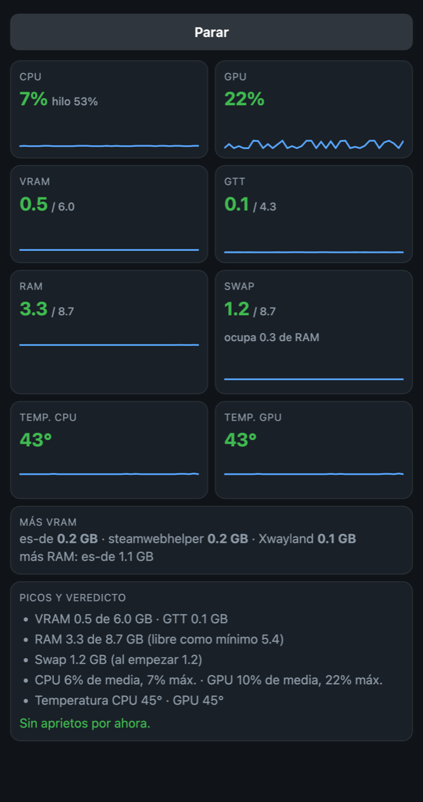

# ps5-bazzite-toolbox

**English** · [Español](README.es.md)

Toolbox for **Linux on the PS5** with the
[VivaLaVent/ps5-bazzite-deck](https://github.com/VivaLaVent/ps5-bazzite-deck) image (Bazzite Deck: Steam in game mode
and the KDE desktop). It is **a single file** that runs on the console and is used to:

- **Diagnose** problems without changing anything, and leave a report to ask for help.
- **Recover the screen or the graphical session** when it goes black.
- **Set up a freshly installed system**: language, VRAM, fan, NAS, EmuDeck/ES-DE… block by block,
  explaining each change and asking first.
- **Add and remove Windows games** in PortProton and Steam in one step, normal or isolated from the rest of the system.
- **Switch the image version** from GitHub (newer or older) with SHA-256 verification, and go back to
  how it was before (in testing).

The interface is in English or Spanish: it follows the system locale (`LANG`; Spanish if it starts with `es`, otherwise English); force it with `--lang es|en` (saved in `~/.config/ps5-bazzite-toolbox.conf` as `TOOLBOX_LANG`). This is not an official project of the image or its authors.

**Test setup** (image versions v1.4 – v1.8, Legacy install):

| | |
|---|---|
| Console | Original "fat" PS5 (IW620 Wi-Fi/Bluetooth chip), firmware 4.50 |
| Jailbreak | [ps5-y2jb-autoloader](https://github.com/itsPLK/ps5-y2jb-autoloader) |
| Linux loader | `ps5-linux-loader-v3.5.elf` ([ps5-linux-loader](https://github.com/ps5-linux/ps5-linux-loader)) |
| Sending the loader | [PS5 Payload Manager](https://github.com/itsPLK/ps5-payload-manager) |
| Disk | 1 TB Lexar ES3 external SSD over USB 3.2 (10 Gb/s, USB `21c4:0003`; stable with `usb-storage.quirks=21c4:0003:u`, which the `usbquirk` part of the `usbdisk` block sets) |

It may work with other models (Slim, Pro), firmwares, loaders or disks, but this is untested.

Each setting explains what it changes, why, and how to undo it, and below you will also find **the equivalent command**, in
case you prefer to do it by hand without installing anything.

> [!IMPORTANT]
> **PS5 says "file system not supported" on firmware 4.03 / 4.50?** The bootc images of VivaLaVent's
> [ps5-bazzite-deck](https://github.com/VivaLaVent/ps5-bazzite-deck) don't mount on those firmwares
> ([issue #47](https://github.com/VivaLaVent/ps5-bazzite-deck/issues/47)). [`utils/ps5-fw4-gpt-fix.py`](utils/ps5-fw4-gpt-fix.py) fixes the image (or a drive already flashed):
> `curl -LO https://github.com/fitamix/ps5-bazzite-toolbox/releases/latest/download/ps5-fw4-gpt-fix.py`
> then `python3 ps5-fw4-gpt-fix.py IMAGE.img --apply`.
> Images **v2.11 and later** come fixed. You only need it for earlier images, or drives already flashed with them.
> Full details: [bootc images on firmware 4.x](#bootc-images-on-firmware-4x-ps5-fw4-gpt-fixpy).

## Contents

- [Quick start](#quick-start)
- [Utilities outside the toolbox](#utilities-outside-the-toolbox): bootc images on firmware 4.x, icon of the YouTube app that boots Linux
- [Menu and command-line options](#menu-and-command-line-options)
- [Diagnostics](#diagnostics)
- [Screen and graphical session](#screen-and-graphical-session)
- [Console settings](#console-settings) (groups, blocks and parts in detail, with their commands)
- [PortProton and Steam](#portproton-and-steam)
- [Switching image version and going back](#switching-the-image-version-and-rolling-back)
- [Backup of your home folder](#backing-up-your-home-folder)
- [Files: what each thing uses and where it saves](#files-what-it-uses-and-where-it-saves-things)
- [Toolbox versions](#toolbox-versions)
- [Things done by hand](#things-done-by-hand)

## Quick start

On the PS5 (terminal or SSH):

```sh
curl -LO https://github.com/fitamix/ps5-bazzite-toolbox/releases/latest/download/ps5-bazzite-toolbox.sh
bash ps5-bazzite-toolbox.sh
```

That link always downloads the **latest published version**. The `main` branch may carry changes not yet published.

The first time, it offers to **install itself** as the `ps5-bazzite-toolbox` command (in `~/.local/bin`, without `sudo`; image
updates do not delete it) and as "PS5 Toolbox" in the KDE application menu.
From then on `ps5-bazzite-toolbox` is enough, and the downloaded file can be deleted. If you prefer not to
install it, it still works with `bash ps5-bazzite-toolbox.sh`.

It runs as your user (not as root). It asks for the `sudo` password only the first time you pick something that
needs it, and does not ask again until you close it.

## Menu and command-line options

With no options it shows a menu (without a terminal, for example when launched from another script, it runs the diagnosis).
Options go by area, each area with its own ten, so their numbers don't move when new ones are added (since 1.14.0);
instead of the number you can also type the option's word (shown in grey). Each option
has its menu-less equivalent (`ps5-bazzite-toolbox --…`, or `bash ps5-bazzite-toolbox.sh --…` if not installed) and, when
there is one, a system command that does the same.

| Menu | Word | What it does | Without menu | Equivalent command (without the toolbox) |
|---|---|---|---|---|
| **Windows games** (PortProton and Steam) | | | | |
| 11 | `instalar` | Install a Windows game (normal or isolated), test it and add it to Steam with its artwork | `--add-game [Game.exe]` | — |
| 12 | `juegos` | My games: change their isolation, frame generation, Windows libraries, Steam artwork, or uninstall them | `--games`, `--change-level Game.exe`, `--framegen Game.exe`, `--libs [Game.exe]`, `--art [--name "Name"]`, `--remove-game [Game.exe\|"Name"]` | — |
| 13 | `art` | Steam artwork for the non-Steam games that have none (Steam store, SteamGridDB) | `--art [--name "Name"] [--key]` | — |
| 14 | `libs` | Windows libraries (Visual C++…) in a PortProton prefix, for all its games | `--libs [Game.exe]` | — |
| 15 | `coleccion` | Sync the "PortProton" collection in Steam (closes Steam) | `--pp-collection [--dry-run\|--yes]` | — |
| — | | Launch a game as option 11 left it (used by Steam and the desktop) | `--run Game.exe` | — |
| **Screen and session** | | | | |
| 21 | `modojuego` | Switch to game mode now and always boot into it | `--session gamemode` | `sudo rm /etc/sddm.conf.d/zzz-ps5-session.conf` and restart the session |
| 22 | `escritorio` | Switch to the KDE desktop now and always boot into it | `--session desktop` | see [Screen and session](#screen-and-graphical-session) |
| 23 | `pantalla` | Black screen: recover the picture (closes nothing) | `--screen` | `sudo chvt 2; sleep 3; sudo chvt 1` |
| 24 | `sesion` | Black screen that 23 does not fix: restart the session (closes Steam and everything open) | `--session restart` | see [Screen and session](#screen-and-graphical-session) |
| 25 | `modo` | Which session the console boots into and which one is running now | `--session status` | `loginctl list-sessions`; `systemctl is-active sddm` |
| **Files** | | | | |
| 31 | `backup` | Backup of your home folder: save (choosing what) or restore, also from another disk | `--backup`, `--restore [folder]` | see [Backup](#backing-up-your-home-folder) |
| 32 | `copias` | Copies with the NAS (copiarNas): see the current and recent ones, stop them | `copiarNas -e`, `copiarNas --parar` | — |
| 33 | `espacio` | How much space each folder takes (also the `espacio` command and the Dolphin right-click) | `--space [folder]` | `du -bsh -- */ .[!.]*/ \| sort -h` |
| **Diagnostics** (look only) | | | | |
| 41 | `monitor` | Watch CPU, GPU, VRAM, RAM, swap, temperature and what uses the most | `--mem` | — (reads `/sys/class/drm/card*/device/mem_info_*`, `/proc/meminfo`, `sensors`…) |
| 42 | `anterior` | Same with the previous boot (after a hang or a forced shutdown) | `--check --boot -1` | `journalctl -k -b -1` |
| 43 | `revision` | Full check of this boot and saves the report | `--check` | `journalctl -k -b 0` and `journalctl -b 0` (the toolbox also interprets them) |
| 44 | `kernel` | Watch the kernel live (Ctrl+C returns) | `--watch` | `sudo journalctl -k -f -n 0` |
| **Console settings** | | | | |
| 51 | `ajustes` | See how the settings are and apply the missing ones, one by one | `--setup --status`, `--setup` | — |
| 52 | `ajuste` | Change a setting or a group (even if done or you said no) | `--setup --only vram,nas` | each block, in [Settings](#console-settings) |
| — | | Apply without asking: the recommended answer, or yours if you had already said yes to a block (useful to set up a new install like the previous one by copying `~/.config/ps5-bazzite-toolbox.conf`) | `--setup --all` | — |
| **System and toolbox** | | | | |
| 61 | `actualizar` | Update this toolbox (shows what is new and asks) | `--self-update [v1.1.0]` | — |
| 62 | `linux` | Image: install another version from GitHub, go back to how it was before updating (in testing) or save a copy | `--update [v1.8.4]`, `--rollback` | see [Switching version](#switching-the-image-version-and-rolling-back) |
| 63 | `toolbox` | Install it as a command and in the application menu, or uninstall it | `--install`, `--uninstall` | — |
| — | | Version and help | `--version`, `--help` | — |
| — | | Interface language (saved; goes before the other options) | `--lang es\|en` | — |

## Diagnostics

Read-only. At the end it offers to save the report (no passwords; see [Files](#files-what-it-uses-and-where-it-saves-things))
and goes over what has caused problems on this console:

- **USB disk:** stalls (`timing out command`), resets, I/O errors and free space.
- **Graphics:** GPU resets, memory errors, available VRAM.
- **System:** kernel hangs, blocked processes, out of memory, programs that suddenly close, whether the
  previous boot ended badly.
- **Temperature and fan**, **network** (router, DNS, Wi-Fi, Bluetooth, NAS), **graphical session** and the state of each
  settings block.

**Live monitor** (option 41): every 2 s it shows the CPU load (average and busiest thread) and GPU load, VRAM, GTT
(RAM that the graphics chip borrows), RAM and swap, all as used/total, the chip temperature (CPU and GPU are the same chip, with a single
sensor) and the programs using the most VRAM. Bazzite's swap is zram (compressed RAM): `2.5/4.3 GB (0.8)` is 2.5 GB in swap that take up
0.8 GB of RAM. With [swap on disk](#swapdisco) it also shows what is on the disk: `12.1/26.7 GB (4.0, 1.4)`. When stopped (Ctrl+C) it summarizes the peaks, says whether VRAM, RAM or both are lacking, whether the swap filled up and whether the
limit is the GPU or a CPU thread, and offers to save every sample to a CSV, with the same columns as the web
monitor's.

## Screen and graphical session

- **Recover the picture** (6): switching to another virtual console and back makes the graphics chip configure the
  HDMI output again. It closes nothing.
- **Restart the session** (7): `systemctl restart sddm` leaves the previous compositor alive and the screen stays
  black. The toolbox first closes the sessions and the compositor, then starts SDDM. By hand:
  ```sh
  sudo systemctl stop sddm
  loginctl list-sessions                      # and for each seat0 session: sudo loginctl terminate-session <id>
  sudo pkill -u "$USER" -x 'gamescope|gamescope-wl|kwin_wayland|plasmashell'
  sudo systemctl start sddm
  ```
- **Desktop / game mode** (8, 9): changes which session the console enters at boot and restarts it right away. The
  desktop is set with `/etc/sddm.conf.d/zzz-ps5-session.conf`; without that file it enters game mode, as the image
  ships. By hand:
  ```sh
  printf '[Autologin]\nUser=%s\nSession=plasma.desktop\n' "$USER" | sudo tee /etc/sddm.conf.d/zzz-ps5-session.conf  # desktop
  sudo rm -f /etc/sddm.conf.d/zzz-ps5-session.conf                                                                 # game mode
  ```

## Console settings

Settings come in **blocks**, and blocks in **groups** (`basic`, `performance`, `nas`, `games`, `desktop`; they run in
that order). Each setting, when offered, explains **what it changes, why, and how to undo it**, and asks with a
recommended answer (`[Y/n]` = yes by default, `[y/N]` = no). What depends on each console (disk, language, NAS…) it
detects or asks.

- **Option 51** (`ajustes`) shows the state of every block (✔ applied, ✘ pending, – not applicable on this console or
  "not applied (your choice)") and then asks whether to apply the pending ones, one by one. Without the menu:
  `--setup --status` only shows it, `--setup` goes through the pending ones.
- **Option 52** (`--setup --only vram,nas`) goes back to a specific block, even if it is already applied or you said no to it:
  it is the way to change a value or undo it. It lists the groups with their blocks, and a whole group works too
  (`--setup --only performance`).
- **Blocks with several parts:** it first lists their parts (✔ done, · pending, – not applicable here) and then asks
  for each pending part, with its own explanation; a single-part block asks once. When you ask for it by name
  (`--only X` or option 52), the parts that are already done are offered again (default: no) so you can change their
  values.
- **Your answers** (language, VRAM, NAS details, what you do not want…) are saved in
  `~/.config/ps5-bazzite-toolbox.conf`, and next time it only offers what is pending. Each part keeps its own answer
  (`SKIP_<part>`) under the name it had in the blocks before 1.18.0, so what you said before and what is already
  applied still count. Saying no to a whole block is saying no to each of its pending parts, and the status shows
  "not applied (your choice)" when you declined all of them.
- **Names:** `--only` and option 52 accept block names, group names and the **old names** (1.18.0 regrouped the
  blocks): the name of a part runs just that part (`--only zram`, `--only bt`, `--only locale`, `--only hdmi`…);
  `cmdline` runs `bootlang` and `usbquirk`; `atajos` runs `exeactions` and `spacetool`; `brave` and `edge`
  run `navegadores`. `updates`, `wifi` and `cpufreq` no longer exist and say so.
- **Coming from an earlier version:** your "no" answers are kept: a "no" to `cmdline` becomes a "no" to `bootlang` and
  `usbquirk`; to `atajos`, to `exeactions` and `spacetool`; to both `brave` and `edge`, to `navegadores`; to `hdmi`,
  `HDMI_KICK=off`. After updating, `vram` shows as pending until you answer the GTT question.
- Some ask for a **reboot**, and those that touch memory or the GPU, for a **power off and boot with the loader**
  (a reboot, including the warm reboot, does not apply them). It says so at the end.

### Summary

| Block | What it does | Recommended | Reboot |
|---|---|---|---|
| **Basic** (`basic`) | | | |
| [`language`](#language) | Language, keyboard and time zone (system, desktop and Game Mode), also from boot | yes | reboot |
| [`usbdisk`](#usbdisk) | USB boot drive without UAS (`usb-storage.quirks`) and without KDE SMART queries | yes | reboot |
| [`controller`](#controller) | Reloads Bluetooth if it boots without an adapter (original PS5) and keeps Steam's Bluetooth enabled | yes | no |
| [`splash`](#splash) | Boot without the loading screen (the logo), which once left it hung | yes | reboot |
| [`kernelmsg`](#kernelmsg) | Fewer kernel messages on the text screen (the "Salina poller" flood) | yes | no |
| [`warmreboot`](#warmreboot) | Warm reboot (without going through the loader), and `ps5-hdmi-kick` to recover the picture if it comes up black | **no** (experimental) | no |
| **Performance** (`performance`) | | | |
| [`vram`](#vram) | Memory reserved for the GPU and a 12 GB GTT (the GPU may borrow RAM) | yes | power off |
| [`gpu40`](#gpu40) | All 40 GPU compute units instead of 36 | **no** (try it yourself) | power off |
| [`memory`](#memory) | Compressed swap (zram) the size of all the RAM with `lz4`; swap on disk behind it; memory settings for heavy emulators | zram yes; the rest **no** | reboot (zram) |
| [`fans`](#fans) | Fan control and target temperature | yes | no |
| **NAS** (`nas`) | | | |
| [`nas`](#nas) | With a NAS: mounts the share over SMB and links the EmuDeck/ES-DE ROMs; the `copiarNas` command; emulator BIOS and ES-DE images from the NAS | yes, if you already gave its details (BIOS and images, no) | no |
| **Games and emulators** (`games`) | | | |
| [`emulators`](#emulators) | Fixes the `es_systems.xml` that EmuDeck leaves behind (and adds Citra); the PS5 controller in RPCS3 in Game Mode too | yes | no |
| [`portproton`](#portproton) | Fast sync and ray tracing for all PortProton games; Dolphin right-click on an `.exe` | yes | no |
| [`unifideck`](#unifideck) | Unifideck (Decky) can launch Windows games again with this image's Python 3.15 | yes, if you have Unifideck | no |
| **Desktop and extras** (`desktop`) | | | |
| [`trash`](#trash) | Trash without a size limit (Dolphin no longer says "the trash is full") | yes | no |
| [`firewall`](#firewall) | Fixes the firewall, which starts "failed" because of a module missing from the kernel | yes | no |
| [`browsers`](#browsers) | Brave and Edge (Flatpak) without asking for the KDE Wallet password, whichever you have installed | **no** | no |
| [`space`](#space) | Dolphin right-click "see what each folder takes up" and the `espacio` command | yes | no |
| [`monitorweb`](#monitorweb) | The live monitor in your phone's browser, always available | **no** | no |

**Removed in 1.18.0:** the `updates` block (it only served non-bootc images), `wifi` (only images older than
v1.5.0; it also no longer removes `module_blacklist=moal` from `cmdline.txt`) and `cpufreq` (images v2.11 or later
already set `schedutil`'s `rate_limit_us` to 10 ms themselves; VivaLaVent issue #53). An old install is harmless; to
remove the `cpufreq` one:
`sudo systemctl disable ps5-cpufreq-calm; sudo rm /usr/local/sbin/ps5-cpufreq-calm /etc/systemd/system/ps5-cpufreq-calm.service`.

The commands for each setting are what the toolbox does, with the default values; change them to your own.

### Basic (`basic`)

`--setup --only basic` goes through the whole group.

#### `language`

Language, keyboard and time of the system, and the same from boot on. It has two parts:

- `locale` — Language, keyboard and time zone
- `bootlang` — Language and keyboard from boot

##### Language, keyboard and time zone (`locale`)

<a id="locale"></a>

**WHAT IT DOES:** system language, keyboard (console, desktop and Game Mode), time zone and automatic network time.
**WHY:** the image ships in English, with a US keyboard and UTC time. Also, Game Mode (gamescope) doesn't read the
system keyboard: a physical keyboard types like a US one (e.g. no @ when logging in through a browser) until it is
set in `~/.config/environment.d`, which it reads at startup. And the KDE desktop keeps its own language in
`~/.config/plasma-localerc`, which stays English (`C.UTF-8`) even when the system's changes; whatever is started from
the desktop inherits it (e.g. the language the toolbox gives a game when installing it from Dolphin).
**It asks:** language (`es_ES.UTF-8`), keyboard (`es`) and time zone (`Europe/Madrid`).

```sh
sudo localectl set-locale LANG=es_ES.UTF-8
sudo localectl set-keymap es
sudo localectl set-x11-keymap es
sudo timedatectl set-timezone Europe/Madrid
sudo timedatectl set-ntp true
mkdir -p ~/.config/environment.d
echo XKB_DEFAULT_LAYOUT=es > ~/.config/environment.d/90-ps5-bazzite-toolbox-keyboard.conf   # Game Mode
kwriteconfig6 --file plasma-localerc --group Formats --key LANG es_ES.UTF-8            # desktop
kwriteconfig6 --file plasma-localerc --group Translations --key LANGUAGE es_ES:es
```

**UNDO:** the same commands with other values; for Game Mode, delete that file; for the desktop, copy the
`~/.config/plasma-localerc.bak-*` the toolbox leaves over it. Steam has its own language and time zone (see
[Things done by hand](#things-done-by-hand)).

##### Language and keyboard from boot (`bootlang`)

<a id="cmdline"></a>

**WHAT IT DOES:** adds `locale.LANG=…` and `vconsole.keymap=…` to `/efi/cmdline.txt` (the options the kernel boots
with, a single line), with a backup first. It uses the language and keyboard of the `locale` part (`es_ES.UTF-8` and
`es` by default).
**WHY:** so that messages and the text console come out in your language and keyboard from boot, not just the
desktop (SSH sessions do not read the ones from `locale`).

```sh
sudo cp /efi/cmdline.txt /efi/cmdline.txt.bak-$(date +%Y%m%d-%H%M%S)
sudo sed -i 's/$/ locale.LANG=es_ES.UTF-8 vconsole.keymap=es/' /efi/cmdline.txt     # a single line; check first that they are not there already
```

**UNDO:** `sudo cp /efi/cmdline.txt.bak-<date> /efi/cmdline.txt`. Takes effect after a reboot.

#### `usbdisk`

Care for the USB drive the console boots from. It has two parts:

- `usbquirk` — USB drive without UAS
- `disk` — No KDE SMART queries

##### USB drive without UAS (`usbquirk`)

**WHAT IT DOES:** `usb-storage.quirks=VID:PID:letters` in `/efi/cmdline.txt`, with a backup first, for the USB boot
disk: `u` = no UAS, `m` = 32 KB transfers (only if `u` is not enough). It proposes `u` for the Lexar ES3
(`21c4:0003`), `u` if this boot already had UAS errors, and nothing if there are none. Not applicable if you do not
boot from USB.
**WHY:** some USB-NVMe adapters with UAS give resets and I/O errors.
**It asks:** the letters (`u`, `um`, or `-` for none).

```sh
sudo cp /efi/cmdline.txt /efi/cmdline.txt.bak-$(date +%Y%m%d-%H%M%S)
lsusb                                          # the VID:PID of your disk, e.g. 21c4:0003
sudo sed -i 's/$/ usb-storage.quirks=21c4:0003:u/' /efi/cmdline.txt     # a single line; change the VID:PID to yours
```

**UNDO:** `sudo cp /efi/cmdline.txt.bak-<date> /efi/cmdline.txt`. Takes effect after a reboot.

##### No KDE SMART queries (`disk`)

<a id="disk"></a>

**WHAT IT DOES:** stops KDE's disk monitor from querying the disk's SMART, and turns off `smartd`.
**WHY:** some USB-NVMe adapters stop responding for about 60 s on that query (the console looks
hung). KDE's SMART warnings are lost. Not applicable if you do not boot from USB.

```sh
printf '%s\n' 'polkit.addRule(function (action, subject) {' \
  '    if (action.id == "org.kde.kded.smart.smartctl") return polkit.Result.NO;' '});' |
  sudo tee /etc/polkit-1/rules.d/50-ps5-no-kde-smart.rules
sudo systemctl restart polkit
sudo systemctl disable --now smartd.service
kwriteconfig6 --file kded6rc --group Module-smart --key autoload false
```

**UNDO:** `sudo rm /etc/polkit-1/rules.d/50-ps5-no-kde-smart.rules; sudo systemctl restart polkit; sudo systemctl enable --now smartd`.

#### `controller`

Making Bluetooth and the controller always work. It has two parts:

- `bt` — Bluetooth that recovers by itself
- `steambt` — Steam's Bluetooth always on

##### Bluetooth that recovers by itself (`bt`)

<a id="bt"></a>

**WHAT IT DOES:** installs `ps5-bt-guard`, a service that at boot and on wake checks that Bluetooth has an
adapter and, if not, reloads the `btusb` driver (up to 2 times). Only on consoles with the IW620 chip (original PS5).
**WHY:** the IW620 sometimes does not respond after its first restart and Bluetooth boots without an adapter
("No default controller available"); the image's `ps5-bt-revive` does not recognize that error.
**By hand:** `/usr/local/sbin/ps5-bt-guard` and `/etc/systemd/system/ps5-bt-guard.service` (the script's `apply_bt`
function); what it does is equivalent to:

```sh
bluetoothctl list | grep -q '^Controller' || { sudo modprobe -r btusb; sleep 2; sudo modprobe btusb; }
```

**UNDO:** `sudo systemctl disable ps5-bt-guard`. If it still does not come back: power off and boot with the loader.

##### Steam's Bluetooth always on (`steambt`)

<a id="steambt"></a>

**WHAT IT DOES:** installs a service for your user, `ps5-steam-bt`, that runs before each game mode start,
with Steam still closed. If in Steam's configuration (`~/.local/share/Steam/config/config.vdf`, `"System"` →
`"Bluetooth"` → `"Enabled"`) Bluetooth is `"0"`, it sets it to `"1"`. If it is already enabled, it touches nothing.
**WHY:** with Bluetooth disabled in Steam (Settings → Bluetooth), Steam turns the adapter off every time it enters
game mode and the controller does not connect. It happens without you touching anything when Bazzite restarts Steam: if game mode drops 5
times in a row, `gamescope-session-plus` puts Steam's base files back, asks to log in again and leaves
Bluetooth disabled. It is fixed before Steam opens, because with Steam open the change is lost when it closes.
It works on any PS5.
**By hand:** `~/.local/share/ps5-bazzite-toolbox/steam-bt-on.sh` and `~/.config/systemd/user/ps5-steam-bt.service`
(the script's `apply_steambt` function); then:

```sh
systemctl --user daemon-reload && systemctl --user enable ps5-steam-bt.service
journalctl --user -b -u ps5-steam-bt          # "switched on" if it had to enable it
```

**UNDO:** `systemctl --user disable ps5-steam-bt`, and delete those two files. If you want Bluetooth off
in Steam, say no to this part: otherwise it is turned on again at the next boot.

#### `splash`

<a id="arranque"></a>

**WHAT IT DOES:** removes the loading screen (*plymouth*): adds `plymouth.enable=0 rd.plymouth=0` to
`/efi/cmdline.txt`, with a backup first. It only shows the Bazzite logo; without it you see the boot text.
**WHY:** once it left a Lexar boot stopped for 3 minutes (`plymouth-read-write.service`) until pressing
`Ctrl+Alt+F3`, and it adds nothing.

**What it does not touch, even though it delays boot:**

- `cardwired`, Bazzite's GPU manager for laptops with two graphics chips: game mode waits for it ~10 s, but
  it starts Steam with `cardwire launch`. Without it, the session drops, Bazzite restarts Steam and it stays on the desktop.
  If a test version masked it, this block turns it back on.
- `ps5-hdmi-kick` runs after reaching game mode.
- The wait for the network is needed by the NAS mount.
- The seconds spent on disks are the kernel detecting the USB.

**By hand:**

```sh
sudo cp /efi/cmdline.txt /efi/cmdline.txt.bak && sudo sed -i 's/$/ plymouth.enable=0 rd.plymouth=0/' /efi/cmdline.txt
systemd-analyze; systemd-analyze blame | head     # after rebooting: how long it takes and what
```

**UNDO:** remove `plymouth.enable=0 rd.plymouth=0` from `/efi/cmdline.txt` (or copy a `.bak-*` over it).

#### `kernelmsg`

<a id="consola"></a>

**WHAT IT DOES:** sets `kernel.printk = 4 4 1 7` in `/etc/sysctl.d/20-consola-silenciosa.conf` (with sudo) and applies it
right away with `sudo sysctl -w kernel.printk="4 4 1 7"`.
**WHY:** this PS5 kernel logs `Salina poller: lock busy, rescheduling` (info level) about 390 times a minute while a
DualSense is connected over Bluetooth. With the console level at 7 they flood the text console you see when gamescope
loses the display. The messages still go to the journal (`journalctl -k`); only the screen output is reduced.
Done when the file has that value and `/proc/sys/kernel/printk` starts with 4.

**UNDO:** `sudo rm /etc/sysctl.d/20-consola-silenciosa.conf` and reboot.

#### `warmreboot`

<a id="hdmi"></a>

**WHAT IT DOES:** enables the image's warm reboot: when rebooting (from Steam, the desktop or
`sudo reboot`) it goes straight back to Linux without going through the PS5 or the loader. With the warm reboot on,
it also offers (yes by default) to install `ps5-hdmi-kick`; the answer is saved as `HDMI_KICK`. (It used to be the
`hdmi` block: `--only hdmi` still works by name.)
**WHY it is not recommended:** it is experimental. On some consoles the picture comes back black or corrupted after the
reboot (that is what `ps5-hdmi-kick`, below, is for), and on the original PS5 Bluetooth sometimes does not come back. A
new kernel always needs a power off and a boot with the loader. Since image v3.0, the Linux-only Bluetooth address
exists only on the PS5 Pro; on the original and the Slim the PS5 pairing is always shared.

```sh
ps5-warm-reboot on          # status: ps5-warm-reboot status
```

**`ps5-hdmi-kick`:** a service that once per boot, when game mode or the desktop appears, switches to console 2
and back (the same as option 23). After a warm reboot, HDMI sometimes comes up black even though everything works.
**By hand:** two files, `/usr/local/sbin/ps5-hdmi-kick` (the script: waits for `gamescope-wl` or `kwin_wayland`,
5 s more, `chvt 2`, 3 s, `chvt` back to the previous console) and `/etc/systemd/system/ps5-hdmi-kick.service` (a `oneshot`
after `graphical.target`). They are in the script's `apply_hdmi` function; then:

```sh
sudo systemctl daemon-reload && sudo systemctl enable ps5-hdmi-kick.service
journalctl -b -u ps5-hdmi-kick                 # what it did on this boot
```

**UNDO:** `ps5-warm-reboot off` and `sudo systemctl disable ps5-hdmi-kick`.

### Performance (`performance`)

`--setup --only performance` goes through the whole group.

#### `vram`

**WHAT IT DOES:** two things that go together:

- **The VRAM**, the memory reserved for the GPU, in `/efi/vram.txt` (bytes in hexadecimal). It offers 2, 4, 5, 6 and 8 GB
  (0.5 GB can still be typed), in 256 MB steps; it recommends 4 GB. With less than 4 GB it asks for confirmation, because
  the image advises against it. What is reserved for the GPU stops being available as RAM.
- **The GTT**, how much normal RAM Linux may lend the GPU when VRAM is full. After you choose the VRAM it asks (yes by
  default) whether to add `ttm.pages_limit=3145728 ttm.page_pool_size=3145728` to `/efi/cmdline.txt`, with a backup first
  (`cmdline.txt.bak-<date>`). That is 12 GB: the GPU may borrow RAM up to that limit; without it the kernel limit is half
  the RAM. **It reserves nothing**: it only uses the RAM the game needs. The answer is saved as `VRAM_GTT=on|off`; the
  block counts as applied only with the `ttm` parameters, unless you said no.

**WHY:** with 512 MB, DX12/UE5 games crash with *Not enough memory*. Since image v3.0.2, Game Mode keeps a 512 MiB VRAM
floor for its own picture (`/etc/ps5-bazzite-deck/vram-floor`), so a game that fills VRAM no longer knocks it out
(*Failed to pin framebuffer*). That is why **4 GB VRAM + 12 GB GTT** is enough for heavy PC games and leaves much more RAM
to emulators than 6 GB. Measured: a heavy Unreal Engine PC game for 40 minutes with VRAM full and up to 1.4 GB spilled to
GTT, no closes; a Switch 2 emulator ran more than 2 h before memory stutters, versus ~35 min at 6 GB.
**It asks:** how much VRAM (`4`, `4G`, `1536M`…) and whether to set the GTT to 12 GB.

```sh
[ -f /efi/vram.txt.orig ] || sudo cp /efi/vram.txt /efi/vram.txt.orig
echo 0x100000000 | sudo tee /efi/vram.txt      # 4 GB (2 GB = 0x80000000, 6 GB = 0x180000000, 8 GB = 0x200000000)
sudo cp /efi/cmdline.txt /efi/cmdline.txt.bak-$(date +%Y%m%d-%H%M%S)
grep -q ttm.pages_limit /efi/cmdline.txt || sudo sed -i -E 's/[[:space:]]*$/ ttm.pages_limit=3145728 ttm.page_pool_size=3145728/' /efi/cmdline.txt
```

**UNDO:** `sudo cp /efi/vram.txt.orig /efi/vram.txt` and remove `ttm.pages_limit=…` and `ttm.page_pool_size=…` from
`/efi/cmdline.txt` (or copy a `cmdline.txt.bak-*` over it). Takes effect only after **powering off** and booting with the loader.

#### `gpu40`

**WHAT IT DOES:** `amdgpu.ps5_cu_unlock=3` in `/efi/cmdline.txt`: the GPU uses all its 40 compute units instead of the
36 that Sony enables (about 11% more). Original PS5 and Slim only (on the Pro they are all already active).
**WHY it is not recommended:** it is the "silicon lottery". On many consoles it works, but on others you get
green dots or other graphical glitches, a purple tint or hangs. Test it for a good while with demanding games;
if you see anything odd, go back to 36. The diagnosis warns if there are GPU faults with all 40 active. Image
updates respect the option.
**It asks:** 40 or 36.

```sh
sudo cp /efi/cmdline.txt /efi/cmdline.txt.bak-$(date +%Y%m%d-%H%M%S)
grep -q ps5_cu_unlock /efi/cmdline.txt || sudo sed -i -E 's/[[:space:]]*$/ amdgpu.ps5_cu_unlock=3/' /efi/cmdline.txt   # 40
sudo sed -i -E 's/ *amdgpu\.ps5_cu_unlock=[0-9]+//' /efi/cmdline.txt               # 36
sudo dmesg | grep active_cu_number                                                # after booting: 40 or 36
```

**UNDO:** option 52 → `gpu40` and choose 36. Takes effect only after **powering off** and booting with the loader.

#### `memory`

How the RAM is shared out and held when a game or an emulator fills it. It has three parts:

- `zram` — zram size and compressor
- `swapdisco` — Swap on disk
- `memoria` — Memory settings for heavy emulators

##### zram size and compressor (`zram`)

<a id="zram"></a>

**WHAT IT DOES:** the zram swap (memory that is compressed inside the RAM itself when it runs short), in two things:
- **Size:** all the RAM, where Bazzite uses half.
- **Compressor:** the algorithm it compresses with. Bazzite uses `zstd`; the toolbox proposes `lz4`.

It goes in a separate file (`/etc/systemd/zram-generator.conf.d/90-ps5-bazzite-toolbox.conf`), without touching Bazzite's.
Takes effect after a reboot, including the warm reboot: the zram is created on every boot.

**WHY the size:** big games fill it and, with no free swap, the system closes them. The zram reserves nothing:
it only uses RAM for what it actually stores.

**WHY the compressor:** the zram compresses exactly when the RAM runs out, which is normally while playing, and while it
compresses, the program that asked for memory waits. With a game that is tight on memory this shows up as stutters.

| Compressor | Speed | How much it stores | What for |
|---|---|---|---|
| **`lz4`** (recommended) | very fast: several times faster than `zstd` at compressing and decompressing | less: ~1.7–2 to 1 | **Gaming**, especially emulators and games that fill the RAM: memory stutters almost disappear |
| `zstd` (Bazzite's) | slower | more: ~2.5–3 to 1 | Desktop with many things open and CPU to spare: more fits in the same RAM |
| `lzo-rle` (the kernel's) | fast, a bit less than `lz4` | similar to `lz4` | Alternative to `lz4` |

Measured on a PS5 with 4 GB of VRAM and Lichii (Switch 2) at 0.5x, with the RAM full:

| | `zstd` | `lz4` |
|---|---|---|
| Drops to 2–5 FPS while playing | one every ~25 s (when talking to characters, when turning) | none in 3.5 minutes (only when entering the world) |
| Average free RAM | 54 MB | 458 MB |
| What is stored in the zram | ~2.5–3 to 1 | 5.3 GB in 3.1 GB of RAM (1.7 to 1) |

`lz4` stores less, so the zram takes somewhat more RAM, but it compresses so fast that the game stops waiting.
If with `lz4` some program gets closed for lack of memory, raise the zram size or add
[swap on disk](#swapdisco).

**It asks:** size (`ram` = all, `ram / 2` = Bazzite's, or in MB) and compressor (`lz4`, `zstd` or `lzo-rle`;
check that the kernel has it). If it finds `91-lz4.conf` (the manual test from before this option), it deletes it:
this part already covers it.

```sh
sudo mkdir -p /etc/systemd/zram-generator.conf.d
printf '[zram0]\nzram-size = ram\ncompression-algorithm = lz4\n' | sudo tee /etc/systemd/zram-generator.conf.d/90-ps5-bazzite-toolbox.conf
sudo reboot
cat /sys/block/zram0/comp_algorithm     # after rebooting: the one in [brackets] is the one in use
```

**UNDO:** `sudo rm /etc/systemd/zram-generator.conf.d/90-ps5-bazzite-toolbox.conf` and reboot (goes back to
half the RAM with `zstd`). To change only the compressor: option 52 → `zram`.

##### Swap on disk (`swapdisco`)

<a id="swapdisco"></a>

**WHAT IT DOES:** creates a swap file on the disk (`/var/swapfile`) with **priority 10**, behind the zram
(priority 100), and keeps it active on every boot with a line in `/etc/fstab`. The zram is still used first: the
disk only comes in once the zram has filled up.
**WHY:** with the zram full, if a program asks for more memory the kernel closes it ("memory shortage avoided").
With swap on disk, the game is slower at those peaks, but keeps going. Tested with Lichii (Switch 2) and a game that
asks for more than 14 GB: without it, it was closed after 9 minutes; with it, it kept going, and the disk only took the peak.
**Risk:** if the system runs from a USB disk and a lot is written to the swap, USB stalls can freeze the whole
system for a few seconds. That is why it is not applied by default: use it if games get closed for memory, and remove it if you
notice the mouse freezing. The monitor ([option 41](#diagnostics) and [web](#monitorweb)) tells you how much of the disk was used.
**It asks:** size in GB (8, 16, 24 or 32; 16 recommended; 0 = remove it). It checks that 20 GB more remain free.

```sh
sudo dd if=/dev/zero of=/var/swapfile bs=1M count=16384 status=progress   # on btrfs: sudo btrfs filesystem mkswapfile --size 16g /var/swapfile
sudo chmod 600 /var/swapfile && sudo mkswap /var/swapfile && sudo swapon -p 10 /var/swapfile
printf '# ps5-bazzite-toolbox (bloque swapdisco)\n/var/swapfile none swap defaults,pri=10,nofail 0 0\n' | sudo tee -a /etc/fstab
```

**UNDO:** option 52 → `swapdisco` with size 0, or `sudo swapoff /var/swapfile`, delete its two lines from
`/etc/fstab` and `sudo rm /var/swapfile`.

##### Memory settings for heavy emulators (`memoria`)

<a id="memoria"></a>

**EXPERIMENTAL.** Linux memory settings for emulators that fill the RAM (Lichii, CheezyEmu, Eglantine).
They come from the guide of [lichii-bc250](https://github.com/lethevimlet/lichii-bc250) ("Step 1"), measured on an
AMD BC-250, which has the PS5's own chip and also runs Bazzite. Only what applies to the PS5: the zram and the disk swap
are the two parts above, and nothing of the board's overclocking or memory carve-out.
**WHAT IT DOES:** asks for each one separately and writes it to its own file (they survive bootc updates):

| Setting | Bazzite | Here | Why |
|---|---|---|---|
| `vm.swappiness` | 180 | 10 | Don't push the game to swap while RAM is still free: getting it back freezes it for seconds |
| `vm.compaction_proactiveness` | 20 | 100 | The GPU asks for 2 MB blocks; with fragmented memory the kernel frees room by pushing the game to swap. Costs some CPU |
| `vm.watermark_scale_factor` | 125 | 300 | Keep RAM free ahead of big area loads (a big area can ask for ~3 GB in 30 s). On the BC-250, 6–14 s freezes went down to 3–4 s |
| systemd-oomd on your session | — | 80 % for 20 s | If memory pressure stays that high, close what causes it instead of leaving the console hung. It can close more than the game (Steam) |

**WHY EXPERIMENTAL:** on an original PS5 with 4 GB VRAM and all four settings on, a Switch 2 emulator ran more than
2 h without memory stutters and pressure stayed under 7 %. Before (VRAM 6 GB, ~8.7 GB of RAM for Linux,
lichii-bc250 v21) the biggest area load had memory pressure at 3.5 % at most and 8 GB in swap. It has not been compared
with Bazzite's values in the same session yet. That is why it is not applied by default.

```sh
printf 'vm.swappiness = 10\n' | sudo tee /etc/sysctl.d/99-ps5-memoria-swappiness.conf
printf 'vm.compaction_proactiveness = 100\n' | sudo tee /etc/sysctl.d/99-ps5-memoria-compaction.conf
printf 'vm.watermark_scale_factor = 300\n' | sudo tee /etc/sysctl.d/99-ps5-memoria-watermark.conf
sudo sysctl --system
sudo mkdir -p /etc/systemd/system/user@.service.d
printf '[Service]\nManagedOOMMemoryPressure=kill\nManagedOOMMemoryPressureLimit=80%%\nManagedOOMMemoryPressureDurationSec=20s\n' | sudo tee /etc/systemd/system/user@.service.d/99-ps5-memoria-oomd.conf
sudo systemctl daemon-reload    # the safety net watches your session from the next login
```

**UNDO:** `sudo rm /etc/sysctl.d/99-ps5-memoria-*.conf /etc/systemd/system/user@.service.d/99-ps5-memoria-oomd.conf`,
`sudo systemctl daemon-reload` and reboot.

#### `fans`

**WHAT IT DOES:** who controls the fan, and what temperature it aims for (60–85 °C; the factory one, 80 °C, is
quiet but hot). Two ways, and the toolbox uses only one:

- **perf**: `ps5-perf`, the one the image ships (v1.5.0 or later). Nothing to install and it updates with the image.
  ```sh
  sudo systemctl disable --now ps5fan.service ps5boost.service      # in case the other way was installed
  echo 'FAN_TARGET=70' | sudo tee -a /etc/ps5-bazzite-deck/perf.conf    # only if you want another target
  ps5-perf on && sudo systemctl enable ps5-perf.service
  ```
- **tools**: `ps5fan` and `ps5boost` from [ps5-linux-tools](https://github.com/ps5-linux/ps5-linux-tools) (the toolbox
  uses revision `f1fa98a`, the one that was reviewed). `ps5fan` turns on the console's own fan control;
  if you choose another target, `ps5-perf` only sets that temperature (without its CPU boost, `CPU_BOOST=0`).
  ```sh
  sudo dnf5 install -y gcc make git
  git clone https://github.com/ps5-linux/ps5-linux-tools ~/ps5-linux-tools
  git -C ~/ps5-linux-tools checkout f1fa98a
  (cd ~/ps5-linux-tools && sudo ./install.sh)
  sudo systemctl enable --now ps5fan.service ps5boost.service
  ```

**The target temperature by image:**

| Image | How it is set | When it counts |
|---|---|---|
| up to v2.7.x | `FAN_TARGET` in `perf.conf`, which `ps5-perf` applies (`/sys/…/ps5-fan/target_temp`) | immediately |
| v2.8 | cannot be done: Linux does not touch the target (Sony's 91 °C) | — |
| **v2.8.1 and later** | boot parameter **`ps5_fan.target=NN`** in `/efi/cmdline.txt` (40 to 91; without it, 80 °C; `0` = Sony's) | **from the next reboot** |

The toolbox detects which one your image has (on v2.8.1+ `/sys/module/ps5_fan/parameters/target` exists, and shows the value
in use) and on v2.8.1+ writes the parameter after backing up `cmdline.txt`. By hand:

```sh
sudo sed -i 's/$/ ps5_fan.target=75/' /efi/cmdline.txt     # and reboot
cat /sys/module/ps5_fan/parameters/target                   # the target in use
```

**It asks:** perf or tools (if the image ships `ps5-perf`), and the target temperature (60–85 °C up to v2.7.x; 60–91 on
v2.8.1+).
**UNDO:** perf → `ps5-perf off`; tools → `sudo systemctl disable --now ps5fan ps5boost`; target → empty in the
block (goes back to the factory 80 °C; on v2.8.1+ it removes `ps5_fan.target=` from `cmdline.txt`).

### NAS (`nas`)

`--setup --only nas` goes through the whole group.

#### `nas`

If you have a NAS, this asks for everything you can do with it (you only give its details once). It has four parts:

- `nas` — Mount the NAS and use its ROMs
- `copiar` — The copiarNas command and the ~/NAS link
- `bios` — Emulator BIOS from the NAS
- `media` — ES-DE images and videos from the NAS

##### Mount the NAS and use its ROMs (`nas`)

**WHAT IT DOES:** mounts a shared folder from a NAS over SMB at `/var/mnt/nas` (on first access, and without blocking
boot if the NAS is off) and makes EmuDeck's `~/Emulation/roms` point to the NAS ROMs. The local
folder stays as `~/Emulation/roms.local`. If you already have an SMB mount in `/etc/fstab`, it reuses it. Needs
EmuDeck installed.
**WHY:** ROMs shared with other machines (e.g. a Steam Deck), without copying them.
**It asks:** the NAS IP, shared folder, user and its password (which is saved in a file readable only by
root), and the path of the ROMs inside the share (`Emulation/roms`). If the NAS has BIOS files, it offers to copy the ones that
are missing.

```sh
rpm -q cifs-utils || sudo dnf5 install -y cifs-utils
printf 'username=USUARIO\npassword=CONTRASEÑA\n' | sudo tee /etc/samba/nas-USUARIO.cred >/dev/null
sudo chmod 600 /etc/samba/nas-USUARIO.cred
sudo mkdir -p /var/mnt/nas
echo "//IP/COMPARTIDA /var/mnt/nas cifs credentials=/etc/samba/nas-USUARIO.cred,uid=$(id -u),gid=$(id -g),vers=3.0,iocharset=utf8,_netdev,nofail,noauto,x-systemd.automount,x-systemd.mount-timeout=15 0 0" | sudo tee -a /etc/fstab
sudo systemctl daemon-reload && sudo systemctl restart remote-fs.target
mv ~/Emulation/roms ~/Emulation/roms.local
ln -s /var/mnt/nas/Emulation/roms ~/Emulation/roms
flatpak override --user --filesystem=/var/mnt/nas          # so the emulators (Flatpak) can see it
```

**UNDO:** `rm ~/Emulation/roms && mv ~/Emulation/roms.local ~/Emulation/roms`, and remove the line from `/etc/fstab`.

##### The copiarNas command and the ~/NAS link (`copiar`)

<a id="copiar"></a>

**WHAT IT DOES:** installs the `copiarNas` command (`/usr/local/bin/copiarNas`) and the link `~/NAS` to the NAS
shared folder. The direction comes from where each path is; NAS paths are written with `~/NAS/...` (Tab completes
them) or `nas:PATH` (relative to the shared folder):

```sh
copiarNas nas:games/X ~/Games         # from the NAS to the PS5
copiarNas nas:games/X                 # from the NAS to the current folder
copiarNas ~/Downloads/X nas:games     # from the PS5 to the NAS
copiarNas -e                          # running and recent copies; follows the running one
copiarNas --parar                     # stops the running copies
```

It measures what has to be copied, checks the free space at the destination and asks (`-s`: don't ask). Then
`rsync` runs as a systemd user unit at the **lowest disk priority** (`IOSchedulingClass=idle`, `Nice=10`; `-n`:
normal priority): it only uses the disk when nothing else needs it. The copy goes on if you close the terminal or
switch to Game Mode; Ctrl+C only stops watching the progress. Running it again resumes it (`--partial`; what is
already the same is skipped). Towards the NAS, links are skipped (SMB does not keep them). Each copy leaves a log
in `~/.local/share/ps5-bazzite-toolbox/copias/` (the last 30). Like `cp -r`: `folder` copies the folder into the
destination, `folder/` only what is inside it. Needs the `nas` part (of this same block).
**WHY:** on a USB disk a big copy (FileZilla, Dolphin) saturates it and the system freezes now and then; and the
desktop windows are closed when switching to Game Mode, cutting the copy.

**UNDO:** `sudo rm /usr/local/bin/copiarNas; rm ~/NAS`.

##### Emulator BIOS from the NAS (`bios`)

<a id="bios"></a>

**WHAT IT DOES:** `~/Emulation/bios` now points to the NAS BIOS folder (`Emulation/bios`; it creates it if it does not
exist). If you have local BIOS files that are not on the NAS, it offers to copy them first (without overwriting anything there). The local
folder stays as `~/Emulation/bios.local`. Needs the `nas` part (of this same block).
**WHY:** a single copy of the BIOS files for all machines.

```sh
cp -rn ~/Emulation/bios/. /var/mnt/nas/Emulation/bios/        # the ones missing on the NAS
mv ~/Emulation/bios ~/Emulation/bios.local
ln -s /var/mnt/nas/Emulation/bios ~/Emulation/bios
```

**UNDO:** `rm ~/Emulation/bios && mv ~/Emulation/bios.local ~/Emulation/bios`.

##### ES-DE images and videos from the NAS (`media`)

<a id="media"></a>

**WHAT IT DOES:** the ES-DE images folder (the `MediaDirectory` one in `~/ES-DE/settings/es_settings.xml`, or
`~/ES-DE/downloaded_media`) now points to the one on the NAS (`Emulation/downloaded_media`). It copies nothing and does not touch
ES-DE's configuration; with ES-DE closed. The local one stays as `<folder>.local`. Needs the `nas` part (of this same block).
**WHY:** screenshots, covers and videos downloaded once for all machines.

```sh
mv ~/ES-DE/downloaded_media ~/ES-DE/downloaded_media.local
ln -s /var/mnt/nas/Emulation/downloaded_media ~/ES-DE/downloaded_media
```

**UNDO:** `rm ~/ES-DE/downloaded_media && mv ~/ES-DE/downloaded_media.local ~/ES-DE/downloaded_media`.

### Games and emulators (`games`)

`--setup --only games` goes through the whole group.

#### `emulators`

Fixes for the emulators. It has two parts:

- `esde` — ES-DE's system list (and Citra)
- `rpcs3` — PS5 controller in RPCS3

##### ES-DE's system list (and Citra) (`esde`)

<a id="esde"></a>

**WHAT IT DOES:** fixes `~/ES-DE/custom_systems/es_systems.xml`, which EmuDeck leaves with Windows paths
(`\…_libretro.dll` instead of `/…_libretro.so`) and a broken tag (`< command>`). If you have Citra (AppImage in
`~/Applications` or Flatpak), it adds "Citra (Standalone)" to Nintendo 3DS. It checks that the XML is still valid;
if not, it leaves the backup. With ES-DE closed.
**WHY:** without this, 3DS (and others) fail with *citra_libretro.dll*. EmuDeck may rewrite the file when it
updates: repeat the block.

```sh
f=~/ES-DE/custom_systems/es_systems.xml
cp "$f" "$f.bak-$(date +%Y%m%d-%H%M%S)"
sed -i -e 's#%CORE_RETROARCH%\\\([A-Za-z0-9_]*\)_libretro\.dll#%CORE_RETROARCH%/\1_libretro.so#g' -e 's#< command>#</command>#g' "$f"
# Citra: in the n3ds block, before <platform>n3ds</platform>, add
#   <command label="Citra (Standalone)">%EMULATOR_CITRA% %ROM%</command>
```

Then, in ES-DE: Other settings → Alternative emulators → Nintendo 3DS → Citra (Standalone).
**UNDO:** copy the most recent `es_systems.xml.bak-<date>` over it.

##### PS5 controller in RPCS3 (`rpcs3`)

<a id="rpcs3"></a>

**WHAT IT DOES:** in RPCS3's input config (`~/.config/rpcs3/input_configs/global/Default.yml`, or the Flatpak's), player
1 moves from the **Evdev** handler on a DualSense to RPCS3's own **DualSense** handler, with the same button layout
(device `"DualSense Pad #1"`, quoted: unquoted, the `#` is read as a comment and RPCS3 finds no controller). Deadzones,
light bar and rumble are untouched. With RPCS3 closed; it keeps a copy (`Default.yml.bak-evdev-<date>`). Only when
player 1 is a DualSense through Evdev.
**WHY:** in Game Mode Steam takes the DualSense for its virtual pad and Evdev can't open it
(`evdev add_device in bindPadToDevice failed`): neither games nor RPCS3's Big Picture mode respond. The DualSense
handler talks to the controller directly (motion, rumble, light bar). Disabling Steam Input for RPCS3 in Steam
(properties → Controller) also helps; the block doesn't do that.

**UNDO:** copy `Default.yml.bak-evdev-*` over `Default.yml`.

#### `portproton`

What makes playing Windows games with PortProton easier. It has two parts:

- `portproton` — PortProton defaults
- `exeactions` — Dolphin actions on an .exe

##### PortProton defaults (`portproton`)

**WHAT IT DOES:** global PortProton settings for all games, except those whose `.ppdb` changes them: fast
sync (FSYNC/ESYNC) and ray tracing. It goes in a marked block of
`~/.var/app/ru.linux_gaming.PortProton/data/user.conf` (with a `user.conf.bak-<date>` backup). See
[Settings for all games](#portproton-and-steam).
**ALSO:** a **Close PortProton** icon on the desktop (`cerrar-portproton.desktop`, in `xdg-user-dir DESKTOP`): it runs
`flatpak kill ru.linux_gaming.PortProton`, force-closing everything PortProton is running (hung game, Wine, tray icon).
**It closes ALL PortProton games at once.**
**WHY:** PortProton ships them off; Steam's Proton includes fast sync, and some games require
ray tracing. Not applicable until you open PortProton once (it creates `user.conf`).
**By hand:** add at the end of `user.conf`:

```sh
# >>> ps5-bazzite-toolbox (bloque portproton) PP_DEFAULTS: PW_USE_FSYNC=1 PW_USE_ESYNC=1 PW_USE_RAY_TRACING=1
for _pp_kv in PW_USE_FSYNC=1 PW_USE_ESYNC=1 PW_USE_RAY_TRACING=1; do
    grep -qs "^export ${_pp_kv%%=*}=" "${PORTWINE_DB_FILE:-/nonexistent}" || export "${_pp_kv%%=*}=${_pp_kv#*=}"
done
unset _pp_kv
# <<< ps5-bazzite-toolbox
```

**UNDO:** delete that block and the icon. For a single game: `export PW_USE_RAY_TRACING="0"` in its `.ppdb`.

##### Dolphin actions on an .exe (`exeactions`)

<a id="atajos"></a>

**WHAT IT DOES:** the Dolphin right-click on an `.exe` offers "Install in PortProton and Steam", "Change isolation" and
"Uninstall" (`~/.local/share/kio/servicemenus/ps5-bazzite-toolbox-add-game.desktop`), which call the toolbox. If it
finds the desktop "PortProton Collection" shortcut that earlier versions created, it deletes it: Steam's collection
updates itself when you install, change or uninstall a game (and by hand with option 15).
**WHY:** install and remove Windows games from the file manager, without opening the toolbox.
They call the toolbox at its current location: if you move it, repeat this part (installed with option 63 it does not
move). If Dolphin was open, close it and open it again. Not applicable if the toolbox is run from a pipe
(`curl … | bash`).

**UNDO:** `rm ~/.local/share/kio/servicemenus/ps5-bazzite-toolbox-add-game.desktop`.

#### `unifideck`

**WHAT IT DOES:** [Unifideck](https://github.com/mubaraknumann/unifideck) (Decky plugin for Epic/GOG/… in Steam)
launches Windows games with the system's Python, but only accepts the versions in its `ACCEPTED_VERSIONS` list (up
to 3.14 in 0.8.0). This image ships Python 3.15, so every Windows launch fails with "No Python 3.10+ interpreter
found" (its [issue #518](https://github.com/mubaraknumann/unifideck/issues/518)). The block adds the system's
version to that list in `~/homebrew/plugins/Unifideck/.../selector.py`, with a copy (`selector.py.orig-<version>`),
and checks that Unifideck then finds Python (otherwise it restores the copy). Only if Unifideck is installed.
**WHY:** temporary until Unifideck fixes it: updating the plugin undoes it (repeat the block; the settings check
shows it as pending). Once upstream accepts your Python, the block shows as done and touches nothing.

**UNDO:** copy `selector.py.orig-*` over `selector.py`.

### Desktop and extras (`desktop`)

`--setup --only desktop` goes through the whole group.

#### `trash`

<a id="papelera"></a>

**WHAT IT DOES:** removes the size limit of KDE's trash (`~/.config/ktrashrc`, the group of your trash folder,
`UseSizeLimit=false`).
**WHY:** by default it is 10 % of the disk; once it is full, Dolphin says the trash is full and won't let you
delete a big folder (a game). Without a limit it grows until you empty it.

**UNDO:** `kwriteconfig6 --file ktrashrc --group "$(realpath ~/.local/share/Trash)" --key UseSizeLimit true`.

#### `firewall`

**WHAT IT DOES:** removes from the firewall zone the services whose module the PS5 kernel does not ship, and restarts
firewalld. On the image it is `samba-client` (finding Windows machines by name), which uses `nf_conntrack_netbios_ns`.
**WHY:** without that module, firewalld cannot load its rules ("Could not process rule: No such file or
directory"), stays **failed** with a minimal zone (`public`: SSH only) and rejects any permanent change
(`RUNNING_BUT_FAILED`). You can see it with `sudo firewall-cmd --state` (`failed`). The toolbox finds those services by looking at
each one's module in `/usr/lib/firewalld`, so it also works if another version ships a different one. With the
`FedoraWorkstation` zone working, ports 1025-65535 are left open to your network, as on desktop Bazzite (KDE
Connect, Steam streaming, the [web monitor](#monitorweb)). A NAS mounted by its IP does not need `samba-client`.

```sh
sudo firewall-cmd --state                                                     # failed = this is happening to you
sudo firewall-offline-cmd --zone=FedoraWorkstation --remove-service-from-zone=samba-client
sudo systemctl restart firewalld && sudo firewall-cmd --state                 # running
# more locked down, instead of the above: sudo firewall-offline-cmd --set-default-zone=public
```

`firewall-offline-cmd` changes the files without going through firewalld, which is why it works with it failed; its
`--remove-service` is something else (compatibility with `lokkit`).
**UNDO:** `sudo rm /etc/firewalld/zones/FedoraWorkstation.xml; sudo systemctl restart firewalld`.

#### `browsers`

<a id="navegadores"></a>

**WHAT IT DOES:** the Flatpak browsers you have installed (Brave, Microsoft Edge) store their passwords without the
KDE Wallet (`--password-store=basic` in their flags file). It asks for each one; if none is installed, it is not
applicable. Not recommended (default: no). The old names `brave` and `edge` are still accepted by `--only`, and a
previous "no" to the two old blocks is carried over.
**WHY:** with autostart, the browser asks for the Wallet password every time. **Careful:** the sessions and passwords
it had already saved can no longer be read; that is why it is not recommended.

```sh
mkdir -p ~/.var/app/com.brave.Browser/config
echo '--password-store=basic' >> ~/.var/app/com.brave.Browser/config/brave-flags.conf
flatpak kill com.brave.Browser
# Edge: the same with com.microsoft.Edge and config/edge-flags.conf
mkdir -p ~/.var/app/com.microsoft.Edge/config
echo '--password-store=basic' >> ~/.var/app/com.microsoft.Edge/config/edge-flags.conf
flatpak kill com.microsoft.Edge
```

**UNDO:** delete that line from `brave-flags.conf` or `edge-flags.conf`.

#### `space`

**WHAT IT DOES:** the Dolphin right-click on a folder offers "See what each folder takes up"
(`~/.local/share/kio/servicemenus/ps5-bazzite-toolbox-space.desktop`), and the `espacio [folder]` command
(`/usr/local/bin/espacio`) does the same in any terminal (also option 33 and `--space`).
**WHY:** to see what eats the disk without installing anything else.
It calls the toolbox at its current location: if you move it, repeat this part. Not applicable if the toolbox is run
from a pipe (`curl … | bash`).

**UNDO:** `rm ~/.local/share/kio/servicemenus/ps5-bazzite-toolbox-space.desktop; sudo rm /usr/local/bin/espacio`.

#### `monitorweb`

<p align="center"></p>

**WHAT IT DOES:** the live monitor from [option 41](#diagnostics) becomes always available in your phone's
browser, at `http://<console IP>:8765` (the toolbox tells you the address; save it to the home screen).
"Start" measures every 2 s CPU (average and busiest thread), GPU, VRAM, GTT, RAM, swap and temperature, with a chart,
the programs using the most VRAM, GPU memory errors, the peaks and the same verdict as option 41
(whether VRAM or RAM is lacking, whether the GPU or a CPU thread is limiting you). Looking at other tabs does not stop it: in the background the page keeps
polling every 15 s. If none is open for 10 minutes (phone locked, tab or browser closed),
it stops measuring on its own. On stopping, the page **asks whether to save the measurements on the PS5**, in the
toolbox folder, `~/.local/share/ps5-bazzite-toolbox/monitor/ps5-mem-<date>.csv` (the same format as
option 41; `MONWEB_CSV_DIR` in the configuration changes the folder); if
you say no, or do not open it again before starting another, nothing is kept.
**WHY:** to see how a game is doing while you play, without SSH or opening anything on the console.
**HOW:** a Python server (the console's own, nothing to install) as a service for your user, without root: it starts
with the session, also in game mode. While waiting it does nothing (about 25 MB of RAM); while measuring, 1% of one thread.
It only shows data and only answers private-network addresses; the firewall opens the port only for your network.
**It has no password**: anyone connected to your network who knows the address can see it. Not recommended by default.
The PS5's CPU and GPU are the same chip, with a single sensor: it shows a single temperature. Each tile explains
what it is when you tap it or hover over it (GTT, swap…), and at the bottom, "What is each thing?", all of them together.

```sh
# the script is the one embedded in the toolbox (look for it between __MONWEB__): ~/.local/share/ps5-bazzite-toolbox/monitor-web.py
mkdir -p ~/.config/systemd/user
printf '[Unit]\nDescription=Monitor PS5\n[Service]\nExecStart=/usr/bin/python3 %%h/.local/share/ps5-bazzite-toolbox/monitor-web.py --port 8765 --csv-dir %%h/.local/share/ps5-bazzite-toolbox/monitor\nRestart=on-failure\nNice=10\n[Install]\nWantedBy=default.target\n' \
  > ~/.config/systemd/user/ps5-monitor-web.service
systemctl --user daemon-reload && systemctl --user enable --now ps5-monitor-web
sudo firewall-cmd --permanent --add-rich-rule='rule family="ipv4" source address="192.168.1.0/24" port port="8765" protocol="tcp" accept'
sudo firewall-cmd --reload                     # change 192.168.1.0/24 to your network: ip -4 route
```

**UNDO:** `systemctl --user disable --now ps5-monitor-web; rm ~/.config/systemd/user/ps5-monitor-web.service
~/.local/share/ps5-bazzite-toolbox/monitor-web.py`, and the same `firewall-cmd` command with `--remove-rich-rule` and
`--reload`.

## PortProton and Steam

In Dolphin (after the `exeactions` part of the `portproton` block), right-click on an `.exe`: **"Install in PortProton and Steam"**,
**"Change isolation"** and **"Uninstall"**. In the menu, the same through options 11 and 12 ("My games").

**Installing a Windows game** (option 11, `--add-game`). First it asks **how it runs**:

- **1) Normal** (what Enter picks): with access to everything, as usual. For games from trusted stores.
- **2) Isolated with network:** without your home folder, the NAS or your other games. With network,
  for online games or games with a launcher.
- **3) Isolated without network:** the same, without network. For games of doubtful origin.

Then it opens the game with PortProton on the desktop, with that isolation, so you can configure and test it, and asks
whether it went well: if yes, it continues (shortcuts, Steam, collection); if not, it stops and leaves everything as it
was (it deletes what the test created and, if you want, the game folder). With `r` it opens it again: PortProton closes
after preparing a new prefix (the recommended libraries, copied from its base prefix, without network), and you have to
press start again.

Why: the PortProton Flatpak can see the **whole system** (`host` permission), so a Windows program launched with it
could delete or encrypt your home folder, the NAS or the saves of other games. An isolated game is launched with fewer
permissions, removed by Flatpak itself:

- no home folder, NAS or other disks, unable to mount disks, and at level 3 no network;
- your real PortProton stays **read-only**: it runs on a copy for isolated games (without your prefixes, in
  `~/.local/share/ps5-bazzite-toolbox/aislado`, synced at every start), with a prefix of its own for the game;
- it can only see and write the game folder, which has to be a local folder of its own (not the home folder, the NAS
  or an external disk). When installing, it shows you the folder and you can change it: if the `.exe` is in a
  subfolder (`sp26/`, `bin/`...) and the data is higher up, enter the upper one. It is saved for when Steam launches it.

**It is not a virtual machine:** it shares screen, sound and controllers (an X11 program can read what is typed in
other X11 windows; close Steam and the browser while testing). Before testing, it gives the VirusTotal link with the
`.exe` fingerprint (nothing is uploaded), and afterwards it warns if anything new has appeared in your real PortProton.
Without network (level 3), Wine does not see controllers connected after the game is already open: connect them before
launching it.

An isolated game is not in the PortProton game list (it would open without isolation from there): only on the desktop
and in Steam, which launch it with `ps5-bazzite-toolbox --run` without asking anything: in Steam (also in game mode) it
is just another game.

**Change isolation** (in "My games", `--change-level` or in Dolphin): you pick the new level, its prefix (with the
saves) is moved between your PortProton and the isolated copy (asking first), it opens the game so you can check it
works and, if you say yes, it rebuilds its shortcuts and its Steam script. The Steam entry does not change: it keeps
the play time, the artwork and the collection. If it was in the shared `DEFAULT` prefix, it starts with a new one and
its saves stay in `DEFAULT`. If you move or delete the toolbox, isolated games do not start from Steam: install it
again (option 63).

After that, it asks at every step:

1. Opens the game with PortProton to test it; PortProton saves its settings in `<exe>.ppdb`.
   - **Language:** if the game includes a Steam emulator (`steam_emu.ini`, `steam_settings/...`, `SteamConfig.ini`,
     `cream_api.ini`) set to a language other than the system's, it offers to change it: many games only show the
     language "Steam" tells them and have no selector of their own. If it comes with a folder of language packs, it
     offers to copy yours.
2. Creates the shortcut the way PortProton does: in its game list and on the desktop (isolated: only on the
   desktop).
3. Adds it to Steam as a non-Steam game (with Steam closed: otherwise Steam deletes the entry when it closes). It
   backs up `shortcuts.vdf` and rewrites it identical except for the new entry.
4. Puts it in the "PortProton" collection in Steam.

**My games** (option 12, `--games`): a single list, by name, of your PortProton games with their level (normal,
isolated with network or without), including those you installed before this version; pick one to change its
isolation, its frame generation, its Windows libraries, its Steam artwork, or to uninstall it.

**Steam artwork** (when adding a game to Steam, in "My games" — one game, or `c` for every non-Steam game without
a cover — or `--art [--name "Name"]`): looks the game up in the **Steam store** (no account needed; most PC games are
there) and downloads its cover, horizontal image, background and logo into Steam's `grid/` folder. What the store
lacks (delisted or non-Steam games) and the small icon come from **SteamGridDB** with your own free API key
(steamgriddb.com → Preferences → API), asked once and kept in `~/.config/ps5-bazzite-toolbox.conf` (`--art --key`
asks again). It shows the matches and asks which one is right; existing artwork is only replaced if you say so, and
the icon is only set with Steam closed. They show after restarting Steam; the Decky SteamGridDB plugin can change
them afterwards. **UNDO:** delete `~/.local/share/Steam/userdata/*/config/grid/<id>*`.

**.NET games** (C#, XNA, FNA — recognised by the CLR header of their `.exe`): when installing one, the toolbox offers
PortProton's **`DOTNET` prefix**, which comes with .NET 2.0-4.8 and 6-9 already installed (PortProton downloads it,
about 3 GB, the first time) and is shared by all your .NET games. With Wine Mono, the stand-in other prefixes have,
many of them fail at start; installing `dotnet48` with winetricks into a new prefix did not fix River City Ransom:
Underground, the `DOTNET` prefix did. Choosing .NET in `--libs` for a game offers the same.

**Windows libraries** (option 14 or `--libs`, by prefix; also from a game: in "My games", with `--libs Game.exe`,
or when testing a new one with option 11, answer `l`): libraries go into the prefix and serve all its games, so the
prefix list says which games use each one. Many games need libraries Windows ships and a new prefix doesn't, above all the "requires Microsoft Visual C++
2015-2022 Redistributable" message. With a game, it uses its prefix and its Proton version (from its `.ppdb`; isolated
games, theirs in the isolated copy) and says which other games share it; without one, the Proton most of that
prefix's games use. It shows which ones it already has and offers the usual ones: `vcrun2022` (Visual C++ 2015-2022, the most requested), `vcrun2013`, `vcrun2012`, `vcrun2010`,
`vcrun2008`, `vcrun2005`, `d3dcompiler_47`, `xact` + `xact_x64`, `physx`, `openal` and `dotnet48` (slow, ~1 GB).
Not DirectX: Proton brings its own. It also takes **any other** by its winetricks name (`xna40`, `d3dx9_43`…) or by
the DLL the error names (`MSVCR120.dll`): it looks it up in winetricks' own catalog and, if several provide it, lets
you choose. `vcrun2015`, `vcrun2017` and `vcrun2019` no longer exist in winetricks: it uses `vcrun2022`. It installs them with PortProton's `winetricks` inside its Flatpak and with a
display (over SSH it takes the desktop's or Game Mode's): PortProton's menu for this, and the official Visual C++
installer without a display, fail. It first copies the prefix's registry to `bak-libs-DATE` inside it (winetricks
doesn't uninstall). With PortProton open it does nothing. `DEFAULT` is shared by most normal games: what is installed
there serves them all.

**Frame generation** (in "My games" or `--framegen Game.exe`): the Lossless Scaling one that PortProton ships
(lsfg-vk, downloaded the first time). It makes up a frame between every two real ones: the game looks like it runs at
double fps (x2) or triple (x3). Enabling it writes to the game's `.ppdb`:

| Line | Value | Why |
|---|---|---|
| `PW_USE_LS_FRAME_GEN` | `1` | Enables it |
| `LSFG_MULTIPLIER` | `2` | x3 only if the game gives about 40 real fps and the screen runs at 120 Hz |
| `LSFG_FLOW_SCALE` | `0.5` | Resolution at which it computes motion. PortProton sets 0.1 (more ghosting); with 1.0 the PS5 runs out of GPU in heavy games and stutters |
| `LSFG_PERF_MODE` | `0` | Quality model (1 = fast) |

From there you change the multiplier, the quality (0.5, 0.75, 1.0) and the model, or remove it (delete those lines).
Tested on a heavy PC game: from about 25 real fps to ~100 on screen, stable. The price is that **the controller
responds a bit later**, and it is more noticeable the fewer real fps the game gives: not for reflex games, 2D games or
games with a lot of text. To see it properly: screen at 120 Hz and no fps limit (quick menu -> Performance). An
isolated game without network cannot download lsfg-vk the first time.

**Uninstall** (in "My games", `--remove-game` or in Dolphin). It asks separately: remove it from Steam (with a backup of
`shortcuts.vdf` and its artwork), delete its shortcuts and its script, and delete its folder from the disk, which it
shows with its size and asks you to type `DELETE` to confirm. Saves stored in the PortProton prefix are kept; the
own prefix of an isolated game is offered for deletion at the end ("no" by default).

**Settings for all games** (`portproton` block):

- **Fast synchronization (FSYNC/ESYNC):** PortProton ships it off; Steam's Proton has it on. Less stutter in games
  that load the CPU.
- **Ray tracing:** the PS5 driver on Linux (RADV) supports it, but PortProton disables it on AMD and games that
  require it do not start. If a game turns it on by itself and runs slowly, lower it in its graphics options or
  disable it just for that game with `export PW_USE_RAY_TRACING="0"` in its `.ppdb`.

PortProton reads its global settings (`data/user.conf`) after each game's, so the block only sets the value when the
game's `.ppdb` says nothing.


## Switching the image version and rolling back

> **On a bootc install** (since v2.5, by flashing the bootc image; **in testing**: not yet tested on a real bootc
> console) `bootc` does all of this and option 62
> only explains it and asks: **update** (`sudo bootc upgrade`, the next one in the channel you follow), **roll back to
> the previous one** (`sudo bootc rollback`) or **change channel or pin a version** (`sudo bootc switch
> ghcr.io/vivalavent/ps5-bazzite-bootc:stable` or `:v2.5.1`; it lists the bootc versions on GitHub). The new one takes
> effect on reboot, and bootc always keeps the previous one. On v2.5 (and on v2.5.1, v2.6.1 or v2.6.2 if they need it)
> it first offers the author's fix without which updating is not possible (`ostree-finalize-staged`). The toolbox
> knows it is bootc from `/run/ostree-booted`, and its version from `/usr/share/ps5-bazzite-bootc/VERSION`. What
> follows is for Legacy.

**Option 62** (`--update [version]`, `--rollback`). On a **Legacy** install (the one before v2.5, which updates in
place) it first asks what you want to do:

1. **Install a version from GitHub.** It lists the published ones (stable, pre-releases and "quick" ones that only
   change the kernel), shows their release notes and warns if one is a pre-release or older than yours. It checks the
   space, downloads, verifies the SHA-256, **saves a copy of the current image** and runs the author's `update.sh`.
   When done it offers to save its output (with the author's undo command), shows the state of your settings and
   reminds you to **power off** and boot with the loader, not reboot.
2. **Go back to how it was before an update** (**in testing**, see below).
3. **Save a copy now** of the image as it is, without updating anything.

You can install any version that is still on GitHub and has an update package, including an older one, **or that you
have downloaded** into a folder of yours (see below). The author withdraws versions from GitHub (on 4 November 2026
only v2.5 and v1.8.9 were left): the ones you save can still be installed from your folder. The author's `update.sh`
up to v2.4 only installs a package with the same kernel as the one that is running: to go down, for example, from
v2.4.1 (kernel 7.3.1) to v2.1.1 (7.3.0), you first go back to a copy with kernel 7.3.0 and install from there. The
toolbox detects this and explains it before touching anything.

**Downloaded versions.** In the version list, `l` adds a folder with downloaded versions (it can be on the NAS,
mounted with the `nas` block); it is saved and shows up next time. The toolbox searches it, up to 3 levels deep, for
the packages as they come in the release (`ps5-bazzite-deck-<version>-update.tar.xz` with its `.sha256`, or
`ps5-quick-<version>.tar.gz`), for example `<folder>/v1.8.4/...`, and merges them with the GitHub ones in a single
list: `[downloaded]` if you have it, `[downloaded, no longer on GitHub]` if it is only in your folder. If a version is
in both places, it uses the copy in your folder (nothing is downloaded; its SHA-256 is checked all the same). The
notes come from GitHub or, if it is gone, from the `NOTAS.md` in its folder. Without network, the list shows only
yours. And every time you install a version from GitHub, it offers to save its package (with its `.sha256` and its
notes) in `<your first folder>/<version>/`, so it stays there if they withdraw it.

By hand, the same as option 43 does (without the copy):

```sh
bash <(curl -fsSL https://raw.githubusercontent.com/VivaLaVent/ps5-bazzite-deck/main/tools/update-latest.sh) v2.1.1
# or step by step: download ps5-bazzite-deck-<version>-update.tar.xz and its .sha256 from the release,
# sha256sum -c ...sha256; tar xJf ...tar.xz; bash ps5-bazzite-deck-<version>-update/update.sh
sudo poweroff                                   # and boot with the loader
```

### Rolling back (in testing)

> **In testing.** It is already tested that the copy saves everything it should (on a PS5 with the v1.8.4 image). What
> remains is testing the rollback and a real update with its copy. If you use it, tell how it went in an
> [issue](https://github.com/fitamix/ps5-bazzite-toolbox/issues).

**The copy** (before each update, or with option 44) saves in
`/var/lib/ps5-bazzite-toolbox/imagen/<date>-v<version>/` everything an update changes:

| Inside | What it saves |
|---|---|
| `efi/` (list in `efi.list`) | the files of the boot partition: kernel (`bzImage`), `initrd.img`, `cmdline.txt` and its copies, `vram.txt` |
| `modules/` | the kernel modules (`/usr/lib/modules/<kernel>`, about 200 MB) |
| `root/` (list in `paths`) | with their original path: the `ps5-*` scripts in `/usr/local`, the `ps5-*` services, udev rules, `modprobe.d`, NetworkManager, `/etc/bluetooth/main.conf`, `/etc/ps5-bazzite-deck/` (hot reboot, Bluetooth, `perf.conf`), the version file... Also what the toolbox installed (`ps5-hdmi-kick`, `ps5-bt-guard`...) |
| `units` | which `ps5-*` services were active |
| `absent` | what did not exist when the copy was made: on rollback it is deleted |
| `info` | version, kernel, date and note |

Each copy takes about 300 MB; the last 3 are kept (it asks before deleting the oldest). The author's copy
(`/var/lib/ps5-update-backup/`) only saves the kernel and the modules: its "undo" leaves the scripts, services and
version file of the new version in place.

**Rolling back** (option 62 -> 2, `--rollback`): you pick a copy and it restores it as is, without network and even if
the kernel is different. It deletes what the new version had added and offers to delete the modules of the kernel that
no longer boots. Beforehand it saves how everything is (a "before going back to ..." copy), so the rollback can be
undone too. What you changed in those parts after the copy (for example with the `gpu40` or `fans` blocks) goes back
to how it was: check it with option 51. Bazzite, Steam, games and your files are not in the copy, because image
updates do not touch them. Afterwards you must **power off** and boot with the loader.

**If the new version does not even boot**, the toolbox cannot help from the console. That is why, when updating and
if it fits, it also leaves the current kernel on the boot partition, in `anterior-toolbox/`. That partition is FAT, so
any computer can read it: plug the USB drive into the computer, copy the files in `anterior-toolbox/` to the root of
the partition, boot the PS5 with the loader and finish the rollback with option 62 -> 2. Its `LEEME.txt` explains it.

## Backing up your home folder

Option 31 saves your home folder (`/var/home/<user>`) to another disk, the NAS or any folder, and restores it here or
on another install: a new disk, the bootc image... Almost everything of yours is there: Steam games and their saves,
PortProton and its prefixes, EmuDeck, ES-DE, Decky plugins, the Flatpaks installed for your user and the settings of
every program and of this toolbox.

**Save** (21 -> 1, `--backup`):

1. You choose where: it offers the mounted disks and the NAS (with their free space) or you type a folder. The copy
   goes in `ps5-copia-<user>/` inside it.
2. You choose what. It measures your folder and lists the folders over 100 MB and, inside them, the places worth
   deciding separately: Steam games, Proton and PortProton prefixes, games installed inside each prefix, RPCS3 PS3
   games, `~/Games`, downloads... You mark or unmark by number, and with `a N` you enter folder N to choose inside it.
   The ones that rebuild themselves come unmarked: caches, trash, Steam shaders and the RPCS3 cache. Small folders and
   loose files are always included.
3. It warns about what would be left broken: PortProton games whose `.exe` is left out, and links to other disks or
   to the NAS (EmuDeck ROMs), which are saved **as a link**, without copying what is on the other side.
4. It checks that it fits, copies and verifies.

| Destination | Format | Why |
|---|---|---|
| Linux disk (ext4, btrfs, xfs) | normal folder with `rsync`; repeating the copy only transfers what changed | can be opened and recovered file by file |
| NAS (SMB), exFAT, NTFS | one `.tar.zst` per folder, checked when finished | SMB and exFAT do not keep Linux links or permissions |
| FAT32 | not possible | does not support files over 4 GB |

Besides your folder, it saves in `sistema/` what a new install does not have: the service that starts Decky
(`plugin_loader.service`) and the list of system Flatpaks (Brave, Heroic...). It does not need `sudo`.

**Where to restore from** (mounting another disk: **in testing**). Without a folder, it lists the copies it finds on
the mounted disks and the NAS, and **the plugged-in Linux disks** that are not the system one, mounted or not. If you
pick a disk, it mounts it **read-only** (and unmounts it when done) and finds your folder inside, also on a bootc
install. If it is a USB disk that its system used without UAS (`usb-storage.quirks=...:u...`, like the Lexar ES3), it
tells you and sets the same now, until you reboot, so the long copy does not give errors: unplug it, plug it in again
and it carries on. By hand:
`echo 21c4:0003:u | sudo tee /sys/module/usb_storage/parameters/quirks` before plugging it in.

**Restore** (21 -> 2, `--restore [folder]`): you give it the copy's folder, or **the one from another install**: the
disk of your previous install plugged in, its home folder or the disk root (`/run/media/<user>/<disk>`; it also finds
it inside a bootc install). You choose what to bring, it checks the space, closes Steam if it is open and copies. It
overwrites files with the same name and deletes nothing else. Afterwards:

- it reinstalls the Decky service and any missing system Flatpaks (from Flathub; with `sudo` and asking);
- it lists links that point to places that are not there now: the NAS ones work again when you mount it with the
  [`nas`](#nas) block, which uses your saved data;
- it offers to apply your saved settings (option 51), which are in `~/.config/ps5-bazzite-toolbox.conf`.

For games to show up in Steam directly, restore with the **same user name** (the Steam, PortProton and link paths
contain it) and with Steam closed. Better to do it over SSH or in a text console (Ctrl+Alt+F3): from the desktop, KDE
may write some of its settings again when the session closes.

By hand, the same (with Steam closed; `--exclude` for each folder you do not want):

```sh
rsync -aHAX --one-file-system --info=progress2 --exclude=/.cache ~/ /run/media/$USER/DISCO/ps5-copia/      # save
flatpak list --system --app --columns=application > /run/media/$USER/DISCO/flatpak-sistema.txt
rsync -aHAX --info=progress2 /run/media/$USER/DISCO/ps5-copia/ ~/                                          # restore
```

## Utilities outside the toolbox

In `utils/` there are standalone tools, related to Linux on the PS5 but separate from the toolbox, to use on the
computer. Each release includes them with
their `.sha256`.

### bootc images on firmware 4.x (`ps5-fw4-gpt-fix.py`)

**`ps5-fw4-gpt-fix.py`** makes a VivaLaVent bootc image, or a disk already flashed with it, mount on a PS5 with
firmware 4.03 or 4.50
([issue #47](https://github.com/VivaLaVent/ps5-bazzite-deck/issues/47)). Without the fix, the PS5 says "the file
system is not supported" and the loader does not find the kernel. With some fast USB 3 readers, the console even
powers off when the disk is plugged in.

The cause: the image's partition table says the first usable sector is 2048. With that value, the firmware 4.x kernel
reads outside the table and does not create the partitions. The utility sets 34, the usual value, in both table
headers. It touches neither the partitions nor the data. It only needs Python 3, on Linux, macOS or WSL.

```sh
curl -LO https://github.com/fitamix/ps5-bazzite-toolbox/releases/latest/download/ps5-fw4-gpt-fix.py
python3 ps5-fw4-gpt-fix.py ps5-bazzite-deck-bootc-vX.img             # shows what it would change
python3 ps5-fw4-gpt-fix.py ps5-bazzite-deck-bootc-vX.img --apply     # fixes the image; then flash it as usual
sudo python3 ps5-fw4-gpt-fix.py /dev/sdX --apply                    # or a disk already flashed (Linux)
```

- Check the image's `.sha256` before fixing it, because it changes afterwards.
- To undo it: `--first-lba 2048 --apply`.
- The first boot expands the root partition and keeps the fix.

Tested with v2.10 on an original PS5 with firmware 4.50: it mounts and boots, also after the first boot.
The details are in [utils/ps5-fw4-gpt-fix.md](utils/ps5-fw4-gpt-fix.md).

### Custom icon for the YouTube app that boots Linux (`y2jb-icon.py`)

**`y2jb-icon.py`** is for the PS5's own system, not for Linux: it makes the custom icon of a YouTube app that boots
Linux (for example the same icon with a "LINUX" banner) **stop disappearing** on every launch. itsPLK's Y2JB autoloader
compares `/user/appmeta/<TITLEID>/icon0.png` on each launch with the icon inside its `download0.dat` and, if they differ,
puts its own back. The tool replaces the icon inside `download0.dat` with yours, of exactly the same size, so the
autoloader "updates"… to yours. It builds the icon from your own copy's (a "LINUX" banner by default, or any image) and
does it all over FTP (`ftpsrv`), keeping a backup to undo it. It needs only Python 3; to build the icon, also Pillow and
etcpak. Tested on an original PS5 on firmware 4.50.

```sh
curl -LO https://github.com/fitamix/ps5-bazzite-toolbox/releases/latest/download/y2jb-icon.py
python3 y2jb-icon.py install --host 192.168.1.x --tid PPSA01651 --dry-run   # shows what it would do
uv run --no-project --with pillow==11.3.0 --with etcpak python y2jb-icon.py install --host 192.168.1.x --tid PPSA01651
```

With the YouTube app closed. To undo: `y2jb-icon.py undo --host … --backup <the copy it saved>`. Details in
[utils/y2jb-icon.md](utils/y2jb-icon.md).

## Files: what it uses and where it saves things

The toolbox leaves nothing outside these places. "Uninstall" (option 63) only removes the command, its menu entry and
its previous copy; everything else stays, and here is how to remove it.

### Its own files

| File | What it is | Created by | Removed with |
|---|---|---|---|
| `~/.local/bin/ps5-bazzite-toolbox` | the toolbox installed as a command | option 63, `--install` (and the menu offer the first time) | option 63 |
| `~/.local/bin/ps5-bazzite-toolbox.v<version>` | the previous version, after updating it (only the last one) | option 61, `--self-update` | option 63 |
| `~/.local/share/applications/ps5-bazzite-toolbox.desktop` | "PS5 Toolbox" in the applications menu | option 63 | option 63 |
| `~/.config/ps5-bazzite-toolbox.conf` | your answers to the settings (language, VRAM, NAS without password, fan temperature, blocks you do not want...), the language chosen with `--lang` (`TOOLBOX_LANG`, `en` or `es`) and your folders with downloaded image versions (`IMG_LOCAL`) | options 51, 51 and 52, `--setup`, `--lang` | `rm` (it asks everything again) |
| `~/.config/ps5-bazzite-toolbox-juegos.conf` | your PortProton games installed with the toolbox: isolation, `.exe`, name and the folder it sees | options 11 and 12 | updated when each game is uninstalled |
| `~/.local/share/ps5-bazzite-toolbox/aislado/` | the PortProton copy for isolated games, with one prefix per game | option 11 or 12 with an isolated game | `rm -rf` (with the isolated games uninstalled: their saves are there) |
| `~/.cache/ps5-bazzite-toolbox-run.log` | what an isolated game says when launched from Steam or game mode | `--run` | `rm` |
| `/var/lib/ps5-bazzite-toolbox/imagen/` | the image copies ([above](#rolling-back-in-testing)) | option 62 | option 62 when making another copy, or `sudo rm -rf` |
| `/efi/anterior-toolbox/` | the kernel from before the last update, with its `LEEME.txt` | option 62 -> 1 | `sudo rm -rf /efi/anterior-toolbox` |
| `<your versions folder>/<version>/` | the package of a version installed from GitHub, with its `.sha256` and `NOTAS.md`, if you accept saving it | option 62 -> 1 | `rm -rf` |
| `<destination>/ps5-copia-<user>/` | the copy of your home folder: `casa/` (the folder or the `.tar.zst` files), `sistema/` (Decky service, Flatpaks, what you left out, sizes) and `ps5-copia.info` (date, user, image, format; it only exists if the copy finished) | option 31 -> 1, `--backup` | `rm -rf` |

### Reports it offers to save

They are first written to a temporary file (`/tmp`) and, when done, it asks: **Enter** saves it in the folder you
opened the toolbox from (from the applications menu, your home folder), you can type another folder, or **n** to not
save it. Without a terminal (launched from another script), it saves it in the current folder without asking.

| File | What it contains | Created by |
|---|---|---|
| `ps5-diag-<date>.txt` | the diagnostic report, without passwords | options 43 and 42, `--check` |
| `ps5-mem-<date>.csv` | one row every 2 s: CPU and GPU load, VRAM, GTT, RAM, swap, temperature and who uses the most (same columns as the web monitor) | option 41, `--mem` |
| `update-<version>.log` | the output of the image updater, with its undo command | option 62 -> 1, `--update` |

An update download goes to `~/ps5-update-<version>/`; when it finishes well it offers to delete it, and if it fails it
stays there so you can retry.

### What each setting changes on the system

| File or folder | Block (part) | Backup |
|---|---|---|
| `/efi/cmdline.txt` | `usbdisk` (`usbquirk`), `language` (`bootlang`), `vram`, `gpu40`, `splash`, `fans` (v2.8.1+) | `/efi/cmdline.txt.bak-<date>` before each change |
| `/efi/vram.txt` | `vram` | `/efi/vram.txt.orig` (the first time) |
| `~/.config/environment.d/90-ps5-bazzite-toolbox-keyboard.conf`, `~/.config/plasma-localerc` | `language` (`locale`) | `plasma-localerc.bak-<date>` |
| `/etc/systemd/zram-generator.conf.d/90-ps5-bazzite-toolbox.conf` | `memory` (`zram`) | — |
| `/var/swapfile` and two lines in `/etc/fstab` | `memory` (`swapdisco`) | — |
| `/etc/sysctl.d/99-ps5-memoria-*.conf`, `/etc/systemd/system/user@.service.d/99-ps5-memoria-oomd.conf` | `memory` (`memoria`) | — |
| `/etc/ps5-bazzite-deck/perf.conf` (keys `FAN_TARGET`, `CPU_BOOST`) and `~/ps5-linux-tools/` | `fans` | — |
| `/usr/local/sbin/ps5-hdmi-kick`, `/etc/systemd/system/ps5-hdmi-kick.service` | `warmreboot` | — |
| `/usr/local/sbin/ps5-bt-guard`, `/etc/systemd/system/ps5-bt-guard.service` | `controller` (`bt`) | — |
| `~/.local/share/ps5-bazzite-toolbox/steam-bt-on.sh`, `~/.config/systemd/user/ps5-steam-bt.service`; changes `"Enabled"` of `"Bluetooth"` in `~/.local/share/Steam/config/config.vdf` | `controller` (`steambt`) | — |
| `/etc/polkit-1/rules.d/50-ps5-no-kde-smart.rules`, `~/.config/kded6rc` | `usbdisk` (`disk`) | — |
| `~/.config/ktrashrc` (`UseSizeLimit` of your trash) | `trash` | `ktrashrc.bak-<date>` |
| `/etc/sysctl.d/20-consola-silenciosa.conf` | `kernelmsg` | `sudo rm` it |
| `/etc/firewalld/zones/<zone>.xml` (the zone without the services whose module is missing) | `firewall` | — |
| `~/.var/app/com.brave.Browser/config/brave-flags.conf`, `~/.var/app/com.microsoft.Edge/config/edge-flags.conf` | `browsers` | — |
| `/etc/fstab` (one line), `/etc/samba/nas-<user>.cred` (NAS password, root only), `/var/mnt/nas`, `~/.local/share/flatpak/overrides/global` | `nas` (`nas`) | — |
| `~/Emulation/roms`, `~/Emulation/bios`, ES-DE images folder | `nas` (`nas`, `bios`, `media`) | the local folder, as `....local` |
| `/usr/local/bin/copiarNas`, `~/NAS`; logs in `~/.local/share/ps5-bazzite-toolbox/copias/` | `nas` (`copiar`) | — |
| `~/ES-DE/custom_systems/es_systems.xml` | `emulators` (`esde`) | `es_systems.xml.bak-<date>` |
| `~/.config/rpcs3/input_configs/global/Default.yml` (player 1) | `emulators` (`rpcs3`) | `Default.yml.bak-evdev-<date>` |
| `~/.var/app/ru.linux_gaming.PortProton/data/user.conf`, `cerrar-portproton.desktop` on the desktop | `portproton` (`portproton`) | `user.conf.bak-<date>`; delete the icon |
| `~/homebrew/plugins/Unifideck/py_modules/unifideck/launcher/proton/infrastructure/selector.py` | `unifideck` | `selector.py.orig-<version>` |
| `~/.local/share/kio/servicemenus/ps5-bazzite-toolbox-add-game.desktop`, `portproton-collection.desktop` on the desktop | `portproton` (`exeactions`) | — |
| `~/.local/share/kio/servicemenus/ps5-bazzite-toolbox-space.desktop`, `/usr/local/bin/espacio` | `space` | — |
| `~/.local/share/ps5-bazzite-toolbox/monitor-web.py`, `~/.config/systemd/user/ps5-monitor-web.service`, a firewall rule (port 8765, your network only) | `monitorweb` | — |
| `~/.local/share/ps5-bazzite-toolbox/monitor/ps5-mem-<date>.csv` (or in `MONWEB_CSV_DIR`): the measurements of a web monitor session, if you say yes when stopping | `monitorweb` | `rm` |
| `/etc/sddm.conf.d/zzz-ps5-session.conf` | options 22 and 21 | — |

### What it touches when installing or removing a game (options 11 and 12)

| File | What it is | Backup |
|---|---|---|
| `<game folder>/<Game>.exe.ppdb` | the PortProton settings for that game (isolated ones add their prefix) | — |
| `~/.var/app/ru.linux_gaming.PortProton/<Name>.desktop` | the shortcut in the PortProton list (normal games only) | — |
| `<Desktop>/<Name>.desktop` | the desktop shortcut | — |
| `~/.var/app/ru.linux_gaming.PortProton/steam_scripts/<Name>.sh` | what Steam launches (for an isolated one, `ps5-bazzite-toolbox --run`) | — |
| `~/.local/share/Steam/userdata/<id>/config/shortcuts.vdf` | the non-Steam game entry (with Steam closed) | `shortcuts.vdf.bak-<date>` |
| `.../config/grid/<appid>*` | the artwork (deleted on uninstall) | — |
| `.../config/cloudstorage/cloud-storage-namespace*.json` | the "PortProton" collection in Steam (option 15) | `....bak-<date>` |
| `steam_emu.ini`, `steam_settings/...`, `SteamConfig.ini`, `cream_api.ini` in the game folder | the language of the game's Steam emulator, if you accept changing it | `....bak-<date>` |

## Toolbox versions

Each published version is in [Releases](https://github.com/fitamix/ps5-bazzite-toolbox/releases) with its
release notes, and the full history in [CHANGELOG.md](CHANGELOG.md). Numbering follows `MAJOR.MINOR.PATCH`:

- **MINOR** (1.**1**.0): new settings blocks, options or checks. After updating, option 51 (`--setup`) offers only the
  new things you still have pending.
- **PATCH** (1.0.**1**): fixes, with nothing new to apply.
- **MAJOR** (**2**.0.0): something that changes how it was used (renamed options, format of saved answers). The notes
  say what to do.

When opening the menu, the toolbox checks (in 4 seconds at most, and silently if there is no network) whether there is
a newer version and tells you. Option 61 (`--self-update`) shows the release notes, asks, downloads, checks the
SHA-256, saves the previous copy as `....v<version>` (only the last one) and replaces the installed one (or, if you did
not install it, the file you run). Your saved answers are not touched.

## Things done by hand

- Change the password (`passwd`): the default is `ps5` and SSH is open on the network.
- Steam: own time zone and language, **Full** RGB range in game mode and on the desktop.
- EmuDeck: **SteamOS** installer, **Steam Machine** device, **Internal** location.
- DualSense: on a PS5 Pro (or on v2.x images without the shared address), pair it over Bluetooth in a profile of its own (PS + Square). On the original and the Slim with image v3.0 or later, the PS5 pairing is shared.
- For a bug report to the image author: their `ps5-report`.

## License

[MIT](LICENSE).
